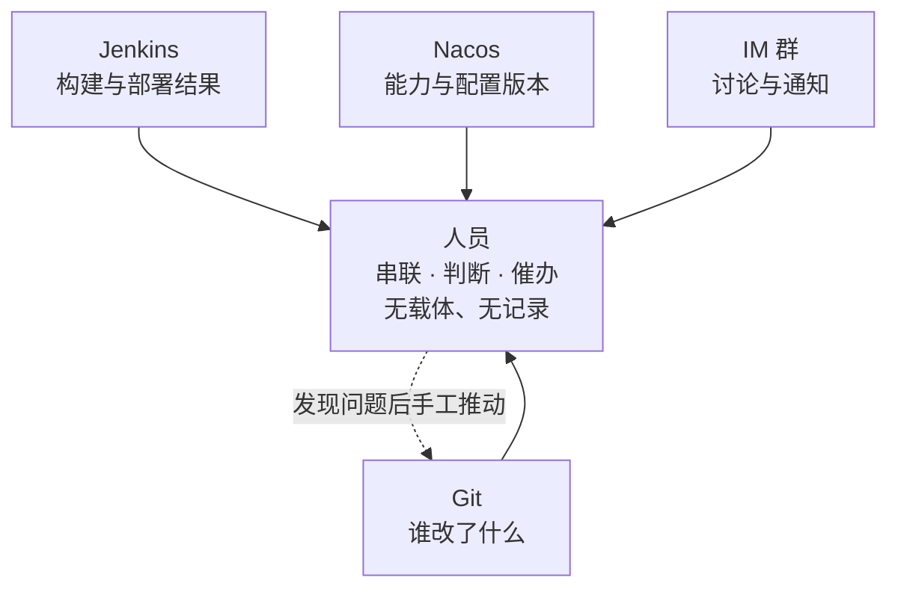
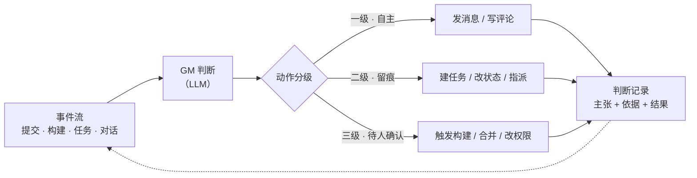
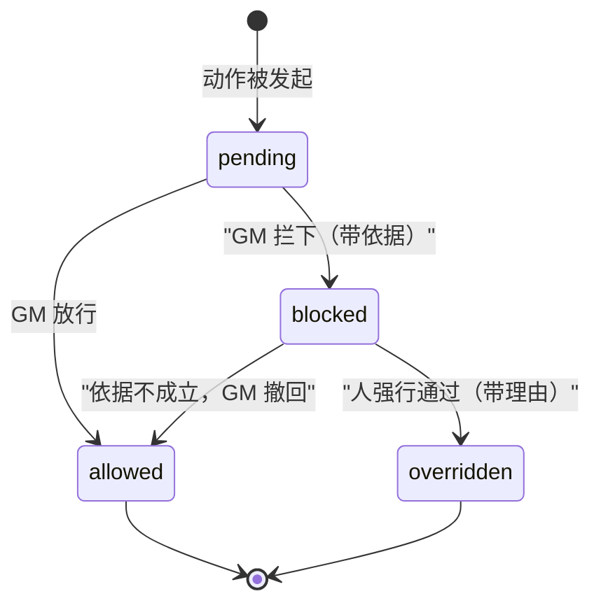

# 协作平台 · 方案（2026-10-12）

> ⚠️ **本文已被 [`平台设计-2026-10-14.md`](平台设计-2026-10-14.md) 取代**（2026-10-14）。
> 保留作历史记录，**内容不再更新** —— 新旧两版之间有两处结构性差异值得知道：
> ① 起点从「平台的核心是一个叫 GM 的角色」换成了「**平台的题目是静默失效**」，GM 降为环上的执行者；
> ② 内核从**并列的六个概念**改成了**一个环**，并多出一条原来没有的回流：**判断记录 → 记忆 → 新的判据**。
>
> 下面这份的第五节（接入）另有新版：[平台设计 §七](平台设计-2026-10-14.md) 补了「MCP 给能力，skill 给用法」。

> 工作名 `collab-platform`，正式名称待定。
>
> **背景**：团队协作的事实目前散落在多个**被动**系统里——代码在 Git、构建在 Jenkins、能力与配置在 Nacos、讨论在 IM。
> 每个系统都只回答被问到的问题，**没有任何一个会主动指出「这里不对」**。
> 与此同时，提交代码的主体正在从人变成 Agent，而现有系统的所有设计前提（人看得懂上下文、人会主动发现问题、人会对结果负责）都在同时失效。
>
> 本文档给出平台定位、核心机制（GM）、边界与待决问题，供评审与排期备案。

---

## 一、结论

**要做的不是「AI 版禅道」。** 禅道的核心是流程规范化——需求怎么走、任务怎么分、Bug 怎么关。它假设执行者是人，所以冗余描述、模糊状态都能靠人对上下文的理解补齐。Agent 不吃这一套：它需要契约化的状态机，任务什么状态、我能不能做、做完交给谁、失败算什么，一条都不能靠「大概理解」。

**真正稀缺的是「有人对结果负责」这个角色。** 现有协作链路里，这个角色由人兼职担任——别人提交代码之后，由人组织审查、跑门禁、追文档漂移、盯发版。这件事真实存在、每天都在发生，但它**没有名字、没有载体、没有记录**，只存在于个别执行者的脑子里和日程上。这个人休假或调岗，它就消失了。

**所以平台的核心是一个叫 GM 的角色**：订阅协作事件流、主动判断、在授权范围内行动、并把每次判断的依据留下来。

三条设计判据：

| 判据 | 依据 |
|---|---|
| **GM 必须是平台里的一个成员，不是特权后台** | 它是最容易出错的一方（LLM 驱动）。后台进程做的事追溯不到，而它恰恰最需要被追溯 |
| **判断必须带依据，「被人推翻」必须留痕** | 被推翻的记录是 GM 改进的唯一输入。只说「这有问题」而不说「凭什么」，等于没有信息 |
| **平台只提供机制，不提供规矩** | 规矩写死在平台里，平台就退化成应用了。策略必须可配置 |

---

## 二、平台是什么 / 不是什么

| | |
|---|---|
| **是** | 人和 Agent 共用的协作层：同一套身份、同一条事件流、同一套动作 |
| **是** | 一个常驻的 GM——把「总要有人发现问题」这件事从人的日程里搬到系统里 |
| **是** | 协议无关的接入点：对外提供 MCP，接入终端可以是任何东西（DSH、Claude Code、网页、别的自动化） |
| **不是** | 不是代码托管、不是 CI、不是 IM。它**聚合**这些系统的事件，不替代它们 |
| **不是** | 不编写任何代码，也不做代码生成 |
| **不是** | 不替团队定流程。流程以可配置策略的形式存在，由团队自己决定 |

**边界的意义**：只要「不写代码、不定流程」这两条守住，平台就还是一个**载体**；一旦哪条破了，它就变成又一个需要人去适应、去维护的应用——而那正是现有工具的毛病。

### 起点：流程还不存在，平台是让它立起来的杠杆

团队现有的做法是「个人拉分支 → 开发完合主干」，或者直接在主干上开发。分支策略形同虚设，代码审查靠人挤时间。这不是纪律问题：**review 本身很耗精力**，而它没有被计入任何人的工作量。

所以平台的定位里有一条容易被忽略：**它不是去适配一个已经存在的 MR 流程，而是要成为那个流程能够立起来的原因**。链路是——

1. review 耗精力 → 没人愿意走 MR → MR 流程建不起来；
2. GM 把 review 的第一遍看掉 → 走 MR 的边际成本降下来 → 流程才走得通；
3. 流程走通了，门禁（主干 protected、只能提 MR）才有落脚点。

这条定位对实现有直接约束：**任何增加 MR 摩擦的设计都是反向的**。「一次事件只留一条评论」「结论要能说清凭什么」「观察期内只提示不阻塞」，都是这条约束的推论，不是各自独立的好习惯。

⚠️ 也因此，平台能跑出东西的前提是**团队开始提 MR**。在流程改变之前，平台接上去只能看到零星几条 MR —— 2026-10-13 实测三个仓库合计 3 条（frontend 0、agent 1、my-app 2），而同期提交是活跃的。这是流程问题，不是技术问题，平台自己解决不了。

---

## 三、核心机制：GM

### 3.1 与被动平台的分界线

现状是所有协作事实都汇聚到人身上：

被动平台（Nacos、Jenkins、禅道）的共同性质：**状态变化由外部触发，系统本身没有意见**。你改它才变，你问它才答。它们可以很好用，但它们不会告诉你「这里有个问题没人管」。

GM 平台与它们的差别只有一个词：**常驻的循环**。

### 3.2 GM 的闭环

**循环里只有「判断」这一段是 LLM 的活。** 取事实、执行动作、写记录都必须是确定性的代码——这是既有实践已经验证过的分工（报告类产物「数字由脚本从源取、判断由人写」，理由是同一条：**手写的数字会漂**，今天写 248，明天补一次提交就成 251，而文档不会自己变，于是它开始说谎）。

⇒ **GM 的输入必须是「取来的事实」，不能是它自己回忆出来的内容。**

### 3.3 动作分级

判据一句话：**这个动作做错了，能不能悄悄改回来、且没人受损。**

| 级别 | GM 能做什么 | 为什么划在这 |
|---|---|---|
| **一级 · 自主** | 读、发消息、写评论 | 做错了纠正一下就行，没人受损 |
| **二级 · 留痕** | 建任务、改状态、指派、打标签 | 可逆，但别人已经看到并可能据此行动 |
| **三级 · 待人确认** | 触发构建、合并代码、改权限 | 难逆或不可逆 |

这条判据不是凭空来的。同一个判断在别处已经用过一次：消息发送类工具**不做自动重试**——因为重发等于让对方收到两条，不可逆。分级只是把这条判据从单个工具推广到整个动作集。

### 3.4 受管辖动作的四态

「能拦」意味着受管辖的动作不是「做 / 不做」二元的：

**两条硬约束**：

1. **GM 拦下时必须给依据**——哪次提交、哪条门禁、哪条策略。
2. **人强行通过时必须给理由**——不能做成一个按钮。否则留痕里只有「某人点了通过」，既没有信息量，也喂不了 GM。

**「被推翻」是这个平台最有价值的一类数据。** 它同时是 GM 的改进输入，和策略是否需要调整的信号。一个只有「通过」和「拦截」、没有「推翻」记录的系统，GM 永远不知道自己错在哪。

### 3.5 GM 自己也在受管之列

GM 是平台里的一个成员，不是特权后台：

- 有 Actor 身份，可以被 `@`、可以被指派、可以被撤权；
- 它的每个动作都写在同一条判断记录里，与人、其他 Agent 的动作格式一致；
- 它自己发起的动作同样走 3.3 的分级与 3.4 的四态。

**依据**：一个拦截机制若只是「挂在某处」，就可能在系统真实经过的生命周期步骤里整体失效——曾有一个权限闸门用「继承并覆写调用入口」的方式实现，单元测试全绿、连续四轮上线验证，**实际一次都没拦到**。根因是框架在装配时复制了那个对象，返回的是基类实例，子类连同覆写一起消失；而测试断言的是「我建的机制被调用」，不是「系统必须有的行为」。

⇒ **判据：凡是要保证「一定会发生」的机制，必须有至少一条走过完整生命周期的用例做锚点。** GM 的权限不能靠它自己遵守，必须在平台层、在动作的必经之路上强制。

---

## 四、平台内核（六个概念）

这六样是「平台」与「应用」的分界。任何一个缺席，平台都会往应用的方向塌。

| 概念 | 是什么 | 为什么必须有 |
|---|---|---|
| **Actor** | 人 / Agent / GM 的统一身份 | 三者的动作要进同一条审计；身份必须在每个接入口稳定可识别，不能依赖某个接入点特有的登录态 |
| **事件流** | 协作事实的收敛点：提交、构建、任务变更、对话、判断 | GM 的唯一输入源。它必须能「取事实」，而不是被要求「回忆事实」 |
| **工作项** | 有状态、有归属、有依据的工作单元 | 协作的最小载体；状态变更本身也是一条事件 |
| **判断** | 谁在什么依据下主张了什么，结局如何 | GM 与人共用同一种表达。可被推翻，推翻留痕 |
| **动作** | 原子化、分级、必经闸门的可执行操作 | 人和 Agent 走同一套动作，审计才可能一致 |
| **策略** | 什么算问题、该怎么处理 | 平台与应用的边界线。策略写死，平台就死了 |

**关于 Actor 的一条现成教训**：同一个人在不同系统里有多种标识（工号、姓名、开放平台 id），工具参数因此反复踩坑——「@ 错人比 @ 不到更糟」。平台层必须有唯一的 Actor 标识，各接入点的原生标识只作为它的别名存在。

---

## 五、接入：一次实现，两个出口

平台的业务逻辑只写一份，对外有两个协议出口：

| 出口 | 给谁 | 形态 |
|---|---|---|
| **REST / 网页** | 人、其他系统 | 常规接口 + 页面 |
| **MCP** | Agent、任何支持 MCP 的终端 | 与 REST 同源的协议适配层，**不复制业务代码** |

这个模式在既有实践中已经跑通：能力服务的同一份业务逻辑双暴露，MCP 端点只是 REST 之上的适配层。

**MCP 作为接入协议的价值在于「终端无关」**——平台不需要知道对面是 DSH、是别的编码助手，还是团队自己写的自动化。这跟「一个配置中心既可以用 API 接，也可以在页面上点」是同一个道理。

### 5.1 待决：MCP 不擅长推送

**问题**：MCP 是请求-响应式的——**Agent 不问，平台就说不了话**。而 GM 的全部价值恰恰在「主动」。

| 候选 | 优点 | 代价 |
|---|---|---|
| 轮询（平台提供 `check_inbox` 一类工具） | 真正的终端无关，任何 MCP 客户端都能用 | 延迟，且空转有成本 |
| 长连接 / webhook | 实时 | 要求每个终端多做一件事，**给「终端无关」打了折** |

这个取舍会渗进协议设计，宜早定。

### 5.2 给接入方的不只是 MCP，还有 skill

**MCP 提供能力，不提供用法。**

`tools/list` 给出的是工具名、参数 schema 和一句话描述。它不告诉接入的 Agent：**什么时候该用**（干完活要申报吗）、**怎么组合**（申报之后要不要回写反应）、**有什么坑**（`title` 是**被检验的主张**而不是依据，随手写会让判据判错，而它无从知道这件事）。

后果是具体的：**Agent 干完活不知道要 `submit_change`，平台就什么都看不到** —— 而「平台看不到」与「这次变更没问题」，在界面上长得一模一样。这正是平台上最不能出现的那种混淆。

所以平台对外要发**两份东西**：

| 出口 | 给什么 | 形态 |
|---|---|---|
| **MCP** | 能力 —— 能做什么 | 工具 |
| **skill** | **用法 —— 什么时候用、怎么用、坑在哪** | 一份 SKILL.md |

两条路**共用同一份正文**：发布到技能注册中心（若对面接的是 AI 中台），或由一个只读工具返回。**不各写一份** —— 复制就是第二份事实源，而第二份事实源迟早会跟第一份说法不一致。

⚠️ skill 只写用法，**不复制工具描述与判据正文**：工具的说明归工具，判据归策略配置，skill 讲的是「把它们串起来的那套动作」。这条纪律来自行途那个 `xingtu-rule-keeper` 的铁律（见[调研笔记](调研-行途开源矩阵-多代理与团队-2026-10-14.md) §5.3），而我们自己已经有一处违犯了它：控制台「?」的口径目前是两份。

---

## 六、待决问题

> **讨论过程与结论的追踪在 [`待决问题.md`](待决问题.md)** —— 本表只登记问题，逐条讨论后在那里更新状态与结论。

| # | 问题 | 影响 |
|---|---|---|
| 1 | Agent 如何得知 GM 找它了（见 5.1） | 协议设计 |
| 2 | 策略用什么形式表达——规则表？自然语言 + 结构化条件？ | GM 的能力上限与可维护性 |
| 3 | GM 是「一个」还是「一类」（一个总协调者，还是按职能拆多个：审查、进度、发版） | 架构与权限模型 |
| 4 | 第一个接入的场景是什么 | 决定第一版能验证什么 |
| 5 | 平台的正式名称 | —— |

**对第 4 条的倾向**：第一个场景用「代码提交后的审查与门禁」这一条链路。理由是需求真实存在（人肉 GM 已经在跑这件事）、事实源头齐全（提交、构建结果都在手边）、失败代价可控（拦错了可以强行通过，且留痕）。

---

## 七、与既有系统的关系

| 系统 | 关系 |
|---|---|
| Git | **事实源头之一**，也是「谁在什么时候改了什么、且不可抵赖」的现成机制。平台的审计可以与提交记录对齐 |
| CI / 构建 | 事实源头之一。构建结果进入事件流，供 GM 判断 |
| 配置 / 注册中心 | 事实源头之一。能力与版本的存在性由它回答 |
| IM | **动作出口之一**（一级动作）。通道本身不是平台 |
| Agent 运行时（对话、工具调用） | 既是事件源，也是一个接入终端 |

**技术底座的倾向**：产品定位独立，但**底座不必从零重搭**。已有一批踩过坑才成型的组件——统一网关、权限 SDK、MCP 聚合层、多租户方案，以及「Agent 调用没有请求头，身份需要从调度上下文里取」这类结论。重来一遍仍要踩，且不与「独立产品」的定位冲突。

---

## 八、版本记录

| 版本 | 日期 | 变更 |
|---|---|---|
| v0.1 | 2026-10-12 | 初稿：定位、边界、GM 机制、平台内核、接入方式、待决问题 |
