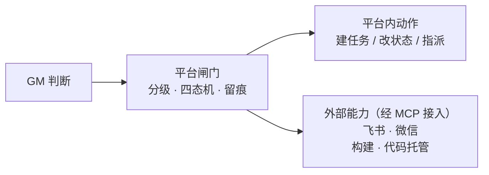
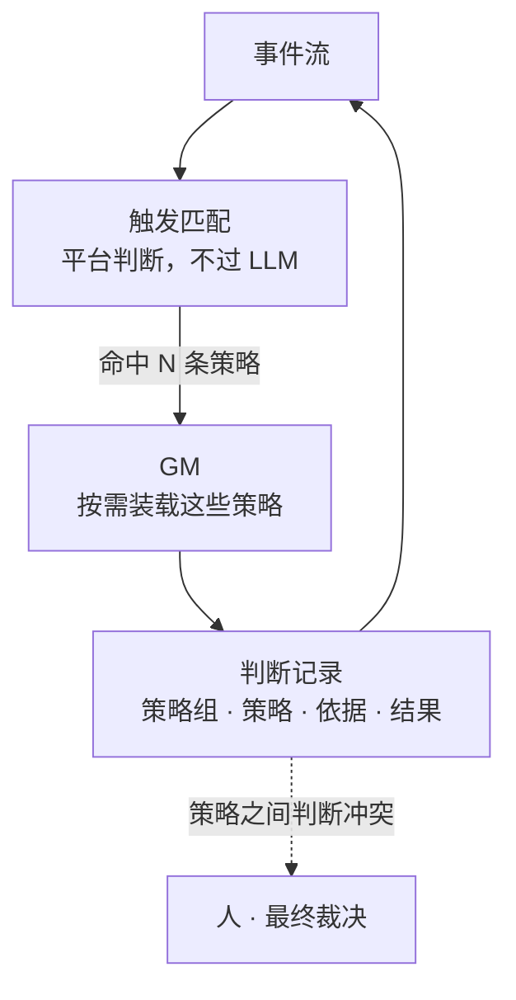

# 待决问题清单

> 本文件追踪协作平台设计中的开放问题。讨论一条、更新一条，结论累积在这里，不散落在对话里。
>
> **状态取值**：`待讨论` / `讨论中` / `已定`
> **来源**：`协作平台方案-2026-10-12.md` 第六节。

| # | 问题 | 状态 |
|---|---|---|
| 1 | Agent 怎么知道 GM 找它了 | 已定 |
| 2 | 策略用什么形式表达 | 已定 |
| 3 | GM 是一个还是一类 | 已定 |
| 4 | 第一个接入场景 | 已定 |
| 5 | 平台正式名称 | 待讨论 |
| 6 | 闸门的落地形态 | 已定 |

---

## 1. Agent 怎么知道 GM 找它了

**状态**：已定

**问题**：MCP 是请求-响应式的——Agent 不问，平台就说不了话。而 GM 的全部价值在「主动」。

**澄清：这不是一个传输机制选型问题，是三件事**

| # | 子问题 | 归属 |
|---|---|---|
| a | 消息存在哪（inbox 的数据模型与生命周期） | **平台可控** |
| b | Agent 怎么知道（投递） | 依赖终端能力 |
| c | 紧急的怎么办（叫停） | **平台可控——走闸门，不走消息** |

子问题 c 看起来属于 b，其实不是：**叫停不该靠消息更快，该靠执行点上拦**（见方案 3.4 四态机）。

**在讨论的候选方案**

- 轮询：平台提供 `check_inbox` 一类工具，由 Agent 侧定时调用。
- 长连接 / 消息订阅：实时，但要求每个终端实现 MCP 之外的协议。

**结论（2026-10-12 定）**

**① 投递分三层，不做长连接。**

| 方案 | 机制 | 成本 | 代价 |
|---|---|---|---|
| 顺带投递 | 任何 MCP 工具的响应里附带 inbox 摘要 | 零 | 只覆盖 Agent 活跃时（而那正是需要它的时刻） |
| 宿主轻量轮询 | 宿主定时查廉价的存在性接口，有新东西才唤起 Agent | 一次 HTTP，不过 LLM | 终端要实现一次 |
| Agent 自己轮询 | Agent 定时调 `check_inbox` | 每次空轮询 = 一次 LLM 调用 | 按 5 分钟一次算，一天 288 次空转 |
| ~~长连接 / MQ~~ | 订阅推送 | 实时 | 每个终端实现 MCP 之外的协议，给「终端无关」打折 —— **不采用** |

**理由**：「实时」在这个场景是伪需求。只有「叫停」对延迟敏感，而叫停走闸门、不走消息（子问题 c）。剩下两种的时效要求是分钟 / 小时级，与 Agent 自身的时间尺度一致——30 秒和 5 分钟的差别对它等于零。

**② inbox 的两条硬约束**

- **待办必须落在平台上**，不能只存在于 Agent 的上下文里——上下文一压缩就忘。载体是 inbox，「开工先看一遍」是纪律，平台要用工具支持它。
- **已读 ≠ 已处理**：投递状态与处理状态是分开的两个维度，都要记。否则 GM 发了、Agent 读了、事没做，没有任何人知道。

**③ 通知出口按 Actor 类型路由，且通道无关**

人走 IM（飞书 / 微信 / 任何以 MCP 接入的通道），Agent 走 inbox。平台**不内置任何具体通道**——通道是可替换的外部能力。

**③-b 补充（2026-10-13 调研修正）：通知出口不是可选件，是 GM 主动性的物理基础。**

原结论 ①②③ 隐含了一个假设——「顺带投递能覆盖 Agent 活跃的全部时段」。调研查出这个假设有个**产品级漏洞**：

> 顺带投递的语义是「**有调用才送达**」，而 GM 的价值恰恰在**没人调用时也能建任务**。

后果：GM 半夜发现构建挂了、建了任务指派给某人，而这个人不主动看板、那个 Agent 也不活跃——任务**存在但无人知晓**。这不是「慢」，是**静默失败**：失败得没有任何声响。

⇒ 两条硬要求：

1. **「建任务」与「通知」是两个必须配对的动作。** 建任务只保证任务存在；通知才保证有人知道。策略的处置段里，`create_task` 一类动作应默认带上对应级别的通知（人走 IM、Agent 进 inbox）。
2. **人这条通道是必须的，且 Agent 的待办要对它的主人可见**——因为 Agent 不活跃时，只有人能把事情推下去。

**规范侧支撑（同日调研结论）**：
- MCP **SEP-2260**（Final）明确**禁止** standalone server-initiated requests，规范把「背景任务里主动 push」列为 PROHIBITED；官方 Tasks 扩展文档原话是 **"Polling is the default."**
- 所以「不做推送」不只是工程取舍，而是**规范遵从**；而规范给出的替代方案原文，正是我们已经选定的形式（*lazily perform these requests within the scope of a client-to-server request*）
- 官方 Triggers & Events WG 正在补这个缺口，但 RFC 状态仍是 `Ideating` → 列入「将来重估」信号（见调研报告）

**④ 外部能力一律经平台中转（由 ③ 推出的必然约束）**

GM **不得直连外部 MCP**。平台能拦住的，只有它自己经手的调用；直连则四态机无从产生、判断记录记不到结果、三级动作停不下来。

⇒ 配套判据：**动作分级匹配 `(动作, 参数模式)`，不只看动作名**——同为「发消息」，发给一个人与 @所有人影响面不同；同为「提交」，进分支与进主干是两回事。

**④ 是 ① 之外唯一影响架构的一条**：它决定了「外部能力注册」是平台的一项内置职能（要能回答「GM 现在有哪些手段可用」），而不是一个可选项。

动作的出入口因此长这样——**平台是唯一的经手方**：



---

## 2. 策略用什么形式表达

**状态**：已定

**问题**：GM 依据什么判断「这里有问题」。规则表？自然语言 + 结构化条件？两者混合？

**什么是「策略」**

**定义**：一条策略 = 一条「**什么时候看、看什么、怎么算有问题、然后怎么办**」的规则。

**类比**：GM 是**岗位**（有身份、有权限、可被 @），策略是这个岗位**工作手册里的一条**。一个「审查 GM」就是一组策略。

**粒度**：一条策略 = 一个**判断单元**（一次触发、一个判据、一组处置）。一个 GM 管 N 种情况就是 N 条策略——它们共享 GM 的身份，但各自独立触发、独立记录、**独立被推翻**。理由：「被推翻」必须能定位到具体规则，否则「被推翻 → 改进」的闭环断在第一环。

**几条真实例子**（均为当前由人承担的工作）：

| 场景 | 什么时候看 | 怎么算有问题 | 怎么办 |
|---|---|---|---|
| 提交进了主干，却没有审查记录 | 有提交进入主干 | 改动范围与它声称做的事不匹配（说改文案、实际动鉴权），或触及敏感路径而无审查 | 建任务给提交者；涉敏感路径则挂起等人确认 |
| 门禁红了，但没人接手 | 构建 / 门禁失败超过 N 小时，且分支无新动静 | 这是不是一次「没人注意到」的失败（已有人处理就别重复催） | 建任务 + 通知责任人 |
| 派生物落后于源 | 定时巡检 | 台账 / 产物的生成时间早于它依赖的源文件（改了源码没重新生成） | 建任务；无人认领时升级给人 |
| 发版前的检查 | 有发版请求 | 有未关闭的高优问题，或构建状态不明 | 挂起发版，等人确认 |

**为什么重要**：这决定 GM 的能力上限与可维护性，也决定「平台」与「应用」的边界是否守得住——策略写死在平台里，平台就退化成应用了。

**结论（2026-10-12 定）**

**① 三段分离。** 策略不是一个东西——三段的确定性要求不同，混在一起表达才是灾难。

| 段 | 内容 | 形态 | 确定性要求 |
|---|---|---|---|
| **触发** | 什么时候唤起 GM | 结构化：事件类型 + 条件 | 必须可靠——漏了等于这件事没人管。**这一段不该有 LLM 参与**：绝大多数事件在此被过滤掉 |
| **判据** | 看出什么算问题 | 自然语言 + **限定的取数范围** | 可以模糊——LLM 的强项。取数范围是硬约束：GM 只能看取来的事实，不能凭记忆 |
| **处置** | 该做什么 | 结构化：映射到动作集 + 分级 | 必须确定——关系到权限与审计。分级匹配 `(动作, 参数模式)` |

**② 形态 = 结构化外壳 + 自然语言内核。** 决定形态的不是技术，是**谁能写它**——只有工程师能维护的策略，会让平台退回「需要人维护的系统」（本方案第一节列的病根）。故排除两个极端：纯 DSL / 规则引擎（门槛过高）、纯自然语言（不可靠、不可测、会漂移）。

正面副作用：三段可由不同的人维护——触发与处置由懂系统的人写，判据由懂业务的人写。

**③ 验证靠事件流回放。** 自然语言的判据无法单测，但事件流本身就是可回放的测试集：用过去的真实事件跑新策略，看判断是否与当时一致；历史上确实出过问题的事件是天然负样本。**这是事件流除喂 GM 之外的第二个用途。**

**④ 失败模式偏向误报。**

| 失败 | 性质 |
|---|---|
| **漏报**（该管没管） | **静默——最危险，没人知道它漏了** |
| 误报（不该管管了） | 吵闹，会让人麻木 |
| 判断错 | 被推翻、留痕——**唯一能变好的那一种** |

⇒ 初期宁可吵。后续调整依据两个比例：**被推翻率**与**被忽略率**（GM 说了话没人理 = 误报信号）。

**附：一条策略实际写出来长什么样**

以「提交进了主干，却没有审查记录」为例：

```yaml
# 策略：提交进了主干，却没有审查记录
id: review-unreviewed-merge
owner: 审查 GM

trigger:                      # 结构化 —— 平台自己判断，不经过 LLM
  on: commit_pushed
  where: target_branch == "main"

gather:                       # 取数白名单 —— GM 只能看这些
  - commit.diff
  - commit.author
  - review_of(commit)
  - work_item_of(commit)

judge: |                      # 自然语言 —— 这一段是给 LLM 的
  判断这次改动是否存在下列任一情况：
  - 改动范围与它声称要做的事不匹配（例如声称改文案，实际动了鉴权逻辑）
  - 触及敏感路径（鉴权 / 配置 / 库表结构 / 密钥）而无对应审查
  - 有审查记录，但审查结论与本次改动无关
  若都不成立，不要报告。

dispose:                      # 结构化 —— 映射到动作集 + 分级
  - do: create_task
    level: 2
    assignee: "${commit.author}"
  - when: sensitive_path_hit
    do: hold_merge
    level: 3
```

**从这条示例能看出的四件事**

1. **触发与处置是结构化的，判据才是人话。** 只有进主干的提交才会唤醒 GM——绝大多数事件在第一层被过滤掉，这正是在省钱的地方。
2. **取数是白名单，不是自由发挥。** GM 只能看这四样，没法「凭印象说这个提交有问题」。这是「输入必须是取来的事实」（方案 §3.2）的落地方式。
3. **分级写在策略里，不是写在 GM 的权限里。** 同一个 GM 在不同策略下能动用的手段不同：这条能建任务（二级），只有触及敏感路径时才拿到挂起权（三级）。
4. **判据里那句「都不成立就不要报告」是有意写的。** 它对应 ④ 的失败模式取舍：怕误报就写这句；怕漏报就反过来写「有可疑即报告，并说明可疑在哪」。

---

## 3. GM 是一个还是一类

**状态**：已定

**问题**：一个总协调者，还是按职能拆多个（审查、进度、发版）？

**为什么重要**：影响架构与权限模型——多个 GM 意味着权限、策略、判断记录都要能按职能分域。

**结论（2026-10-13 定，推翻 10-12 初稿）**

**① 不按职能分实例。按职能分的是「策略组」，不是「身份」。**

分不分实例，背后是**同一个 LLM**——「分开」带来的能力差异是零，只有身份和配置的差异。用一个模型扮演六个角色，不会让其中任何一个变聪明。

**策略组的作用**（这些都不需要一个独立 Actor 来承载）：可理解（一眼看出平台在管哪些事）· 可维护（改审查的策略不会碰到发版的）· 可授权（谁能改哪组策略、哪组策略才允许用三级动作）。

**② 真正需要独立身份的判据：受众或治理边界不同。**

一句话：**同一个身份能同时被同一批人 @、被同一批人治理，就够用了。**

| 情形 | 是否独立身份 |
|---|---|
| 审查 / 进度 / 发版（同一团队、同一批人看） | 否——一个身份够 |
| 某职能对外发消息（客户群），受众不同 | 值得独立 |
| 平台服务多个团队，治理边界不同 | **必须独立** |

**③ 结构：按需装配，不是全量加载。**

一个事件来了，平台先做触发匹配（不经过 LLM），只把命中的那几条策略交给 GM。



**④ 冲突升级给人（原则不变，来源变了）。**

冲突从「GM 之间冲突」变成「同一个 GM 内两条策略给出相反处置」——例如审查策略要挂起、紧急修复策略要放行。裁决权仍在人手里：**GM 不该自己消化冲突**，它是 LLM 驱动的，事后只看到结果，看不到它权衡的过程。

**⑤ 空间维度（2026-10-13 新增并定）**

按多空间设计，**第一版只服务一个团队**。

「空间」不是凭空多出的一层，它就是「平台里每个对象都要能回答『它属于谁』」——渗透到 Actor、事件流、策略、判断记录、GM 身份。第一版不做注册 / 配额 / 计费，**只做数据归属**。

依据：留位置的边际成本极低（一个归属字段 + 一层过滤），不留的返工成本极高（所有表加字段 + 所有查询改 + 历史数据迁移）——后者的现成代价见 AI 中台多租户方案。

**⚠️ 错题本：初稿的三个论据全部不成立**

| 原论据 | 为什么不成立 |
|---|---|
| **最小权限**：合成一个 GM 就必须持有最高那档权限 | 第 2 条已定「分级写在策略里」——平台按策略放行，与 GM 是一个还是多个**无关** |
| **上下文成本**：几十条策略塞一个上下文会降质 | 策略按触发条件**按需装配**：一个事件来了只挑命中的几条交给 LLM，不需要全量加载 |
| **审计粒度**：判断记录要能追到哪条策略 | 记录带策略 id 就够了，不需要靠 GM 身份来区分 |

- **当时怎么判断的**：把「职能」直接等同于「身份」——于是三条本该由策略或平台机制解决的问题，都被算成了「需要拆实例」的理由。
- **依据是什么**：动作分级的权限顾虑（初稿写于第 2 条定稿之前）。
- **为什么错**：第 2 条定下「分级写在策略里」之后，这三条前提同时失效，而第 3 条的结论没有跟着回头检查。
- **靠什么发现的**：用户追问「GM 还要分类吗？我没理解这个分类的目的是什么，不都是一个 llm 吗？要分职责？」
- **共同教训**：**结论要跟着前提走**。第 2 条与第 3 条写于同一天，但一个讲「形式」、一个讲「结构」，写的时候没有联系起来。

---

## 4. 第一个接入场景

**状态**：已定

**问题**：第一版先让 GM 管哪条链路。

**结论（2026-10-13 定）**

**① 场景：提交进入主干前的审查与合并。**

三条理由本身就足够，**不需要附加「别人没做过」这个能被证伪的主张**（见调研 §四的修正）：

- **需求真实存在**——这件事现在由人肉承担（团队提交代码后由人组织审查、跑门禁）
- **事实源头齐全**——提交、CI 结果、审查记录都在手边，GM 不需要凭空获取
- **失败代价可控**——拦错了可以强行通过，且留痕

**② 第一组策略：只做两条，性质不同。**

| 策略 | 性质 | 观察期 | 它验证什么 |
|---|---|---|---|
| **敏感路径变更** | **纯规则**（路径匹配），不需要 LLM | **不需要**——客观匹配不存在误报 | **管道**：事件 → 策略 → 动作 → 留痕能否走通 |
| **改动与声称不符** | LLM 判据 | 需要 | **判断**：LLM 判据到底准不准 |

**为什么就这两条**：一条验证管道、一条验证判断。这两件事都清楚了，再加判据才是加法而不是赌博。

**第一条的价值不在判断，在于它能让整条链路立刻跑起来**——不需要调模型、不需要等观察期、不存在误报。它是第一个能证明「这个平台真的在管事」的东西。

**第二条为什么选「改动与声称不符」**：它是 LLM 判据里最客观的一类——不是让模型评价代码好不好，而是**拿 diff 去检验主张**。
⚠️ **边界**：MR 描述是**主张**（提交者可控），它的角色是**被检验的对象**，不是**判断的依据**——主张进不了 `gather` 白名单，但可以进判据。这个区分不绕，但实现时极易被做成「信 MR 描述」。

**③ 敏感路径清单——首版从既有教训里取，且它本身是数据不是代码。**

首版（由人维护、可随时增删、**增删本身留痕**）：

- 鉴权 / 权限相关代码
- Nacos 配置
- 库表 SQL 与迁移脚本
- CI 与部署脚本
- **团队规则文件**（`AGENTS.md` 这类——它们会改变所有后续行为）
- 密钥与凭据相关

**④ 观察期：只设采集，不设判据。**

**不预设阈值。** 调研只给了方向（跑够样本、误报率可接受）而没给数字；**在没有任何数据之前定阈值就是盲拍**。所以：

- 观察期**不做「达标就升级」的自动判断**；
- 所有信号照采（见 ⑤）；
- **升级由人看着数据决定**——升不升、什么时候升，都是人的判断。

**⑤ 采集字段**（技术实现，已定）：

| 类别 | 字段 | 用途 |
|---|---|---|
| 触发 | 时间 · 策略 id · 触发事件（MR / 提交 id） | 用来知道「足够多样本」到底是多少 |
| 结论 | 判据报了什么 · **引用了哪些事实**（`gather` 白名单里的哪几项） | 后者用于事后判断「它是不是基于事实说的」 |
| 人的反应 | 采纳 / 明确否定 / 无视 | 三个都记，但**只有「明确否定」进升级条件** |
| 时间差 | 从报出到有人反应隔了多久 | 有些「无视」其实是「还没看到」，没有时间戳分不开 |

**⑥ 升级机制**

- **升级动作**：处置从「只发消息」→「挂起合并」
- **谁按按钮**：**人**——不能是 GM 自己（自己确认自己）
- **可降级**：升级后误报也能降回来。**这条必须对称**，否则升级是单向的，而单向升级的终点是「所有判据都拦着」
- **留痕**：策略变更本身是一条事件（GM 的行为基线变了，这值得记）

**⑦ 谁来提出「该评估了」——不能让复盘依赖人想起来。**

数据采了没人看等于白采（既有教训：「不信人会记得跑脚本，人会遗忘也会离职调岗」）。所以由 **GM 主动报数据**：「这条判据跑了 47 次，明确否定 2 次，采纳 31 次，这是明细。」

⚠️ **措辞边界要写死**：GM 报的是**数据**，不是「我建议给我更多权限」。前者是信息，后者是游说——**一个会主动给自己要权限的 GM，比一个只会报数的 GM 危险得多。**

---

## 5. 平台正式名称

**状态**：待讨论

**问题**：正式名称。

**当前**：工作名 `collab-platform`。

**结论**：待定

---

## 6. 闸门的落地形态（2026-10-13 新增并定）

**状态**：已定

**问题**：GM 判断「不能合」这个结论靠什么落地——发一个 check 警告，还是把合并权收回来？

**结论**

**① 强门禁：主干只允许通过 MR 合并，且 Allowed to merge = GM + 管理员。**

环境事实（2026-10-13 实测）：代码托管在**自建 GitLab**——`gitlab.example.com` 与 `gitlab.example.com:9090` 均为 GitLab（响应头 `Server: nginx`、页面标题 `Sign in · GitLab`）。

| 角色 | GitLab 权限形态 | 能不能合并 |
|---|---|---|
| 普通开发者 | Developer——可提交 MR、可推非保护分支 | **不能** |
| **GM** | 受保护分支的 Allowed to merge | 能——**正常路径，门禁在这里** |
| 管理员 | Allowed to merge（同一份名单） | 能——**兜底通道，每次使用都留记录** |

主干设 protected：**Allowed to push 为空**、**Allowed to merge = GM + 管理员**。这样「绕过」不是一个需要去检测的动作，而是**根本没有这个动作存在**——有人合了，那只可能是这两个主体之一。

**② 为什么用强门禁而不是发 check**：发 check 只能表达「我不同意」，绕过它不需要任何显式动作（不理会即可）；把合并权收回来之后，**绕过本身成为一个显式动作**，天然可观测。这比「定期对账检测差异」干净——对账永远要回答「这处差异是有人绕过，还是平台漏记」，而归因永远模糊。

**③ 管理员的每次手动合并要分清两种性质**（判据：**GM 有没有机会表态**）：

| 情形 | 记为什么 |
|---|---|
| GM 判断了、拦了，管理员推翻 | `overridden`——这是有价值的改进信号 |
| GM 根本没参与，管理员直接合 | `forced`——这不是 GM 判断力问题 |

**若两种都记成「GM 被推翻」，推翻率照样是脏的**（同 §3 的 Gerrit 六态修正）。

**④ 人工通道不能变成常用通道**——这是加在 GM 身上的**性能要求**：判据要有响应时间预算，慢的判断应拆到单次调用。否则 GM 一慢，人工通道事实上就成了主路径，门禁的意义落空。

**⑤ 一个明确的边界**（不假装能覆盖）：如果绕过发生在服务端之外——直接改服务器上的仓库文件、或管理员关掉保护设置——任何轻量门禁都看不见。Gerrit 那种深度接管能覆盖，我们这种覆盖不了。**这是选择轻量的代价，认了并写下来。**

**⑥ GM 判据的输入要区分「事实」与「主张」**：提交消息、MR 描述是**提交者可控的主张**，不该是判断的主要依据；事实应来自 diff、CI 结果、代码本身。这与策略三段的 `gather`（取数白名单）是同一件事——白名单放客观来源，自述降为参考。

---

## 待办

> 这些**不是「待决」** —— 方向已经定了，只是还没做。列在这里是为了不丢，不是为了再讨论一次。
> 与上面各节的区别：上面每一节都在等一个决定；这里每一条都在等一个人动手。

### 一、已做完（2026-10-14 一轮清掉九条）

| # | 做了什么 | 提交 | 当时的判据（留着，别只记结论） |
|---|---|---|---|
| **T1** | `hold_merge`（级别 3）+ **「拦得住吗」的自检**；动作三条件补上回滚 | `cd03b0d` `997ba8e` | 没自检的话它会**假装拦住了** —— 实测这个环境里它确实拦不住（见下） |
| **T4** | 「零命中」信号 | `ca06293` | **「拦不住」与「没什么可拦」在数据上长得一样** |
| **T5** | desc / 正文预算守卫 | `0e090f5` | **description 是常驻税**；写成守卫时它当场抓到自己的两个 bug |
| **T6** | 批量表态 | `7a2b47c` | **循环取胜的前提是验证成本低廉** —— 逐条回写贵到没人做 |
| **T7** | 策略补 `trigger`（三段齐了） | `7f6c5fd` | ⚠️ 触发不通过（静默跳过）与**取数失败**（落 error）是两件事 |
| **T8** | 策略补 `notFor` | `7f6c5fd` | **「不看什么」比「看什么」更能防职责重叠** |
| **T9** | 旁证（不需要人的置信度信号） | `3b524c0` | ⚠️ 但验证时发现：**它与 notFor 是冲突的**，见下 |
| **T10** | 守卫补行级豁免 | `3098960` | 豁免必须**行级**，文件级等于开一张空白通行证 |
| **T11** | 策略状态补 `off` | `ca06293` | **一个标签若能对应两种截然不同的现实，它就不是合格的探针** |
| **T13** | 判断记录支持「条件成立」 | `86b00e7` | 「条件成立」**不是第四种结局**，它是结论的限定 |

### 二、还做不了的（都卡在平台之外）

| # | 待办 | 卡在哪 |
|---|---|---|
| **T2** | 「数据够了算够」的判据 | **卡在数据**。它要观察期的真实反应分布才能定阈值，而观察期需要有人真的在用 —— 现在库里全是测试数据。**现在定就是拍脑袋** |
| **T3** | 阶段二 / 三的排期 | **卡在场景**。排期的依据是「谁在用、什么时候要」，而现在没有实践场景 |
| **T12** | 验一次「改源码后要先 build」这条声称 | **卡在重启**。本机 MCP 包装脚本注释里写了这条，逻辑上成立（跑的是 dist），但没验证过 —— 改一处源码、不 build、看 DSH 里是否真的还是旧行为。**要重启 DSH 才能验** |

### 三、这一轮里新长出来的三条

前两条是**判断**，第三条是**待办**。

1. **旁证与职责隔离是冲突的**（`3b524c0`）。职责隔离（`notFor`）要求策略**不重叠**；交叉验证要求**重叠**。调研里那四个角色审的是**同一份材料**，所以必然重叠；我们的策略审的是**不同方面**，所以设计上不该重叠。**结论**：机制留着（将来加一条「凭据泄漏」策略时它会与敏感路径撞在同一个文件上），但**不该指望它现在能替代人的反应**。

2. **级别 3 的「拦」在这个环境里拦不住任何人**（`997ba8e`，实测定论）。自建 GitLab 是**社区版**（`15.7.2`、`enterprise: false`），Blocking merge requests 是 Premium 特性（`/blocks` 返回 404）；而分支保护现状是 `main` 允许 **Maintainers** 合并、`test` **根本没保护**。`hold_merge` 因此带一条自检，会把这件事直接说出来 —— 但**主干保护配置要先做**，那属于环境侧改动。

3. **「零命中」的阈值 20 是拍的**（`policy/health.ts`）。它只用来提示、不触发动作、不进任何统计的分母。真要让它有依据，得等 T2 那份数据。
| **T14** | 给待决项写默认值 | 调研八轮 §12.3 | 判据：**待拍板必须带默认值，未回即按默认执行，不阻塞往下写**。控制台设计 §六 那 5 条现在**没有一条写了默认值** —— 是「不回就悬着」 |
