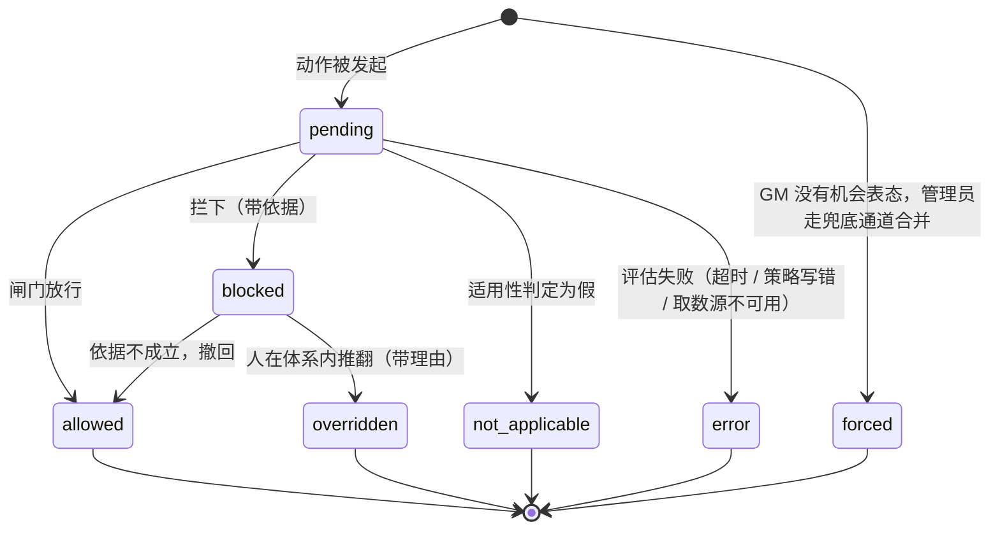
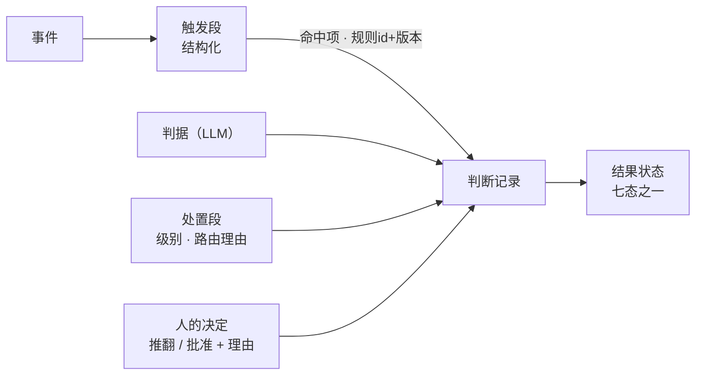

# 设计修正提案（2026-10-13）

> **输入**：`协作平台方案-2026-10-12.md`（v0.1）· `待决问题.md`（第 1–3、6 条已定）· 四份调研报告。
> **输出**：逐条可执行的修改项，按优先级排序。每条标明改哪个文档的哪一节、依据、依赖、与现有设计的关系。
> **判据**：P0 = 不定就没法往下设计 · P1 = 影响架构 · P2 = 优化与备忘。

---

## 〇、怎么读这份文档

### 0.1 依据的四份报告

| 代号 | 报告 | 在本文档里承担什么 |
|---|---|---|
| **竞品** | `调研-竞品与相关项目.md` | 品类扫描与四份专项的整合摘要；给出「哪些设计已被别人占掉」的诚实结论 |
| **协议** | `调研-MCP生态与Agent协议选型-2026-10-13.md` | MCP/A2A 规范级结论，决定投递、inbox、外部能力中转的形态 |
| **审计** | `调研-GM动作审计与人在回路-业界做法-2026-10-13.md` | 判断记录的字段、身份与委托、人在回路的现成结构 |
| **门禁** | `调研-自动化审查与合并门禁-2026-10-13.md` | 分量最重的一份：拦截强度分档、覆盖语义、留痕粒度、学习闭环，跨三十年四个技术世代 |

引用格式：`报告代号 §节号`；原始来源以 URL 给出，均可回溯。

**来源分层标注**（沿用协议报告头部的约定，正文每一处 `来源` 行按此标注）：

| 标签 | 含义 |
|---|---|
| **【规范】** | 官方规范明确规定（MCP / A2A 规范、SEP、RFC、IETF 草案原文） |
| **【SEP】** | 官方提案，已 Final 或已落地 |
| **【孵化】** | 官方工作组进行中 |
| **【第三方】** | 外部测量 / 厂商文档 / 开源项目，正文带子类后缀 |

【第三方】的子类后缀，用来判断一条结论**能不能进论证链**：

| 子类 | 含义 | 用法 |
|---|---|---|
| **【第三方·产品文档】** | 工具 / 平台 / 开源项目自己的官方文档与 README（CodeRabbit、Greptile、Cursor-Bugbot、Mergify、Renovate、Gerrit、GitHub、Prow、Zuul、Danger、Bors、reviewdog、mcp_agent_mail…） | **一手，但是产品方的自述**。机制描述可采用；**厂商自报的效果数字一律不进论证链** |
| **【第三方·测量】** | 独立第三方测量（如 State of the MCP Registry 对官方 registry 的全量探测） | 可采用，但需核对分母与样本口径 |

只写报告节号（如「门禁 §3.1①」）的来源，指的是四份调研报告自身的结论，不外引。

**引用「业界没有」时必须先归类**——否则会把「没查到」写成「不存在」：

| 归类 | 判据 | 下游怎么用 |
|---|---|---|
| **业界确实没有** | 官方规范明确没有 / 官方文档明确说做不到 / **多个独立实现一致确认「止步于此」** | 可当设计空白去填，或当结构性边界去遵守 |
| **只是没查到** | 检索未定位 / 官方文档只是没提 / 一手原文未取到全文 | **不能**当空白。要么再查一轮，要么在设计里**预留可替换点** |
| **不可达** | 付费标准 / 机构文档 / 需特定权限 | 标注可达性限制，不写成「业界没有」 |

### 0.2 优先级判据

| 级别 | 判据 | 处理方式 |
|---|---|---|
| **P0** | **不定就没法往下设计**——它的取值会决定其他对象的数据模型或流程 | 必须在下一版方案定稿前拍板 |
| **P1** | 影响架构——不改也能往下画，但改晚了要返工 | 随对应模块的设计一并定 |
| **P2** | 优化与备忘——不阻塞设计，记下来免得丢 | 进设计备忘，需要时再取 |

### 0.3 条目格式

```
### P0-n 标题            ← 前缀即优先级（P0 / P1 / P2）
**改什么** —— 文档 + 章节 + 具体改法
**为什么** —— 哪份报告的哪条结论 + 来源（带 0.1 的分层标注）
**依赖** —— 依赖哪些条目先落地
**关系** —— 替换 / 补充 / 冲突；跨级调整的条目在此写明调整理由
（必要时追加 **待确认**）
```

### 0.4 10 条已知底线的落点

| # | 底线 | 落点 |
|---|---|---|
| 1 | 四态机扩为七态（补 `FORCED` · `NOT_APPLICABLE` · `ERROR`） | P0-1 |
| 2 | inbox 状态集对齐 A2A `TaskState` | P0-3 |
| 3 | 判断记录字段 = `REQ-AUD-1` 七元组 + 路由理由 + 规则引用 | P0-5（前置 P0-4） |
| 4 | 覆盖分「破窗」与「豁免」两类 | P0-2 |
| 5 | 判据与阻塞强度解耦 | P0-6 |
| 6 | 被管辖者不能修改管辖它的策略 | P0-8 |
| 7 | 「建任务」与「通知」必须配对 | P1-20 |
| 8 | 文件租约（并发资源占用） | P0-10 |
| 9 | 闸门装在被收紧的合并权上，不是装在客户端 hook 上 | P0-11 |
| 10 | 按判据成熟度逐个升级阻塞强度 | P0-7（目标档位见 P0-12） |

### 0.5 统计

P0 13 条 · P1 22 条 · P2 19 条（合计 54 条）· 不建议采纳 26 条 · 待确认 14 项。

### 0.6 编号对照

分级调整后编号有变动。逐条核验时用下表换回旧号：

> 编号未变不等于内容未变——按独立审查结论修订过的条目，改法都写在各条正文里（含「为什么这样改」），本节只负责编号映射。

| 现编号 | 原编号 | 变化 |
|---|---|---|
| P0-1～P0-8 | P0-1～P0-8 | 原号保留 |
| P0-9 | P0-10 | 原号顺延 |
| P0-10 | P0-11 | 原号顺延 |
| P0-11 | P0-12 | 原号顺延；**重写为强门禁形态**，原第 1、2 条移入 P1-21 |
| P0-12 | P1-16 | **由 P1 提级** |
| P0-13 | P1-17 | **由 P1 提级** |
| P1-1～P1-15 | P1-1～P1-15 | 原号保留 |
| P1-16 | P1-18 | 原号顺延 |
| P1-17 | P1-19 | 原号顺延 |
| P1-18 | P1-20 | 原号顺延 |
| P1-19 | P1-21 | 原号顺延 |
| P1-20 | P0-9 | **由 P0 降级** |
| P1-21 | — | **新增**（原 P0-12 的第 1、2 条） |
| P1-22 | P2-18 | **由 P2 提级** |
| P2-1～P2-17 | P2-1～P2-17 | 原号保留 |
| P2-18 | P1-22 | **由 P1 降级** |
| P2-19 | — | **新增**（产品总线） |

---

## 一、P0 —— 定了才能往下设计

### P0-1 受管辖动作的状态机：四态扩为七态

**改什么** —— `协作平台方案-2026-10-12.md` §3.4「受管辖动作的四态」改为七态，状态图补三条入口迁移。现有四态 `pending / allowed / blocked / overridden` 保留，新增三态：

| 新状态 | 含义 | 与现有四态的差别 |
|---|---|---|
| `not_applicable` | **这条策略不适用于这一个动作**（适用性判定为假） | 与「适用但没通过」分开——现有四态里没有这一维 |
| `forced` | **GM 没有机会表态的合并**（管理员走兜底通道直接执行） | 与「体系内被推翻」分开——现有四态把两者混在 `overridden` 里 |
| `error` | **评估本身失败**（判据超时 / 策略表达式写错 / 取数源不可用） | 与「评估成功但没通过」分开——三态里没有这一维 |



**为什么** —— 门禁 §2.2 与 §3.1②；`待决问题.md` §6③。

**（1）七态的来源与 `forced` 的清洗作用。** Gerrit 的 submit requirement 状态机（`NOT_APPLICABLE / UNSATISFIED / SATISFIED / OVERRIDDEN / FORCED / ERROR`）是本项目四态机的直系祖先，`FORCED` 的官方定义原文是「The change was merged directly bypassing code review by supplying the submit option while doing a git push」。
最关键的一条理由：**若把「人绕过 GM 直接干」记成「GM 被推翻」，会得出「GM 判断力差」的错误结论——实际是 GM 根本没机会判断**。这会直接污染「被推翻记录是唯一改进输入」这条判据的数据质量（方案 §3.4 与 `待决问题.md` §2「粒度」）。

**（2）`forced` 的可观测性不是自动获得的。** Gerrit 的 `FORCED` 之所以是一个干净的状态，是因为它发生在**服务端的 push 接收流程**里：绕过的那一方仍然必须把这次 push 交给 Gerrit，服务端因此看得见。把观测点放在 `pre-commit` / `pre-push` **客户端钩子**上不成立——那是每台开发机上的 `.git/hooks/`，`--no-verify` 可以直接跳过，**跳过之后不留任何痕**。照那种设计，`forced` 要么观测不到（绕过完全不入账，比记错更糟：推翻率的分母干净了，却漏掉一整类真实事件），要么只能依赖「有人在那个系统上装了能上报的 hook」这种不可控前提。

`待决问题.md` §6 已把落地形态定案为**强门禁 + 管理员兜底**：主干设 protected，`Allowed to push` 为空、`Allowed to merge = GM + 管理员`，普通开发者只能提 MR。这样「绕过」不是一个需要去检测的动作，而是**根本没有这个动作存在**——有人合了，只可能是这两个主体之一。据此，`forced` 与 `overridden` 的判据为：

| 情形 | 记为什么 | 判据 |
|---|---|---|
| GM 判断了、拦了，管理员推翻 | `overridden`——这是有价值的改进信号 | **GM 有机会表态** |
| GM 根本没参与，管理员直接合 | `forced`——这不是 GM 判断力问题 | **GM 没有机会表态** |

**若两种都记成「GM 被推翻」，推翻率照样是脏的。**判据落成一句话：**GM 有没有机会表态**。这是实现上唯一需要判断的东西——不需要去猜「这次是不是绕过」，只需要问「合并之前 GM 收到过这个动作吗」。

**（3）明确边界：这套门禁覆盖不了什么**（写下来，不假装能覆盖）。若绕过发生在服务端之外——直接改服务器上的仓库文件、或管理员关掉保护设置——**任何轻量门禁都看不见**。Gerrit 那种深度接管（配置存在 `refs/meta/config`、改它要走 code review）能覆盖，本项目这种形态覆盖不了。**这是选择轻量的代价，认了并写下来。**它带来一条实现约束：门禁的覆盖率声明只能写到「**经本平台合并入口的合并**」，不能写成「主干的所有变更」。

**（4）`error` 是状态机的完备性缺口，不是一条可挂起的待确认。** 除 `error` 之外的六态里，`pending → allowed / not_applicable / blocked` 三条迁移**都假设了「评估成功」**：

- `not_applicable` = 评估成功且适用性为假
- `allowed` = 评估成功且通过
- `blocked` = 评估成功且未通过

**没有任何一条覆盖「评估失败」**。一个 LLM 判据超时、一个策略表达式写错、一个取数源挂了——这些动作现在无处可去。而 `pending` 不能永远挂着，实现时最可能被写成 `allowed`。

⇒ **硬规则：评估失败绝不等于通过。**它既不能落到 `allowed`，也不能落到 `blocked`，必须有自己的落点并**可被下游区分**。判据是：*这个动作最终要能被查询到「它为什么停在这里」——若答案是「因为评估失败了」，这个原因必须能被表达出来，且必须与「因为评估成功了但没通过」分开。*

它与判据输出的第三态 `inconclusive`（证据不足时承认而不猜，见 P1-8）**是同一类需求的两个来源**：一个是评估没跑完 / 没跑对（`error`），一个是评估跑完了但证据不足以定论（`inconclusive`）。二者的共同点是**承认做不到，而不是猜一个结论**，因此共享同一条硬规则——**都不得落到 `allowed`**。区别在落点：`error` 是动作在状态机里的落点；`inconclusive` 是判据的一种输出，它的处置由策略的处置段显式配置（默认值取向见 P0-13）。

**依赖** —— 无。

**关系** —— **替换** §3.4 的四态；与「被推翻是最有价值的一类数据」兼容，且正是这条数据的清洗机制。`error` 一态的加入使 P0-5 判断记录里「结果状态」字段的取值域随之确定为七态。

来源：【第三方·产品文档】<https://gerrit-documentation.storage.googleapis.com/Documentation/3.14.3/config-submit-requirements.html>。强门禁形态与 `overridden`/`forced` 的判据出自 `待决问题.md` §6（2026-10-13 实测记录，代码托管在自建 GitLab：`gitlab.example.com` 与 `gitlab.example.com:9090`）。

**待确认** —— 判据输出 `inconclusive`（证据不足）的默认处置档位：落在「挂起等证据」还是「P0-12 的 1b 档（显式命名的中间档）」，未定。它与 `error` 同类但落点不同，需按第一版判据的实际误报分布来选。

---

### P0-2 覆盖模型：两类覆盖 + 覆盖者的主体资格

**改什么** —— `协作平台方案-2026-10-12.md` §3.4「两条硬约束」之二（人强行通过必须给理由）扩展为完整的覆盖模型：

1. **覆盖分两类**：`break_glass`（破窗——显式操作、必须留痕、产生醒目审计信号）与 `exempt`（豁免——静默跳过，只发给可信高频自动化）。
2. **`overridden` 只能由「人在体系内推翻这一条判断」产生**；「某主体本来就不受这条策略约束」走 `exempt`，**不进推翻率**。
3. **覆盖者的主体资格**：产生 `overridden` 的人 ≠ 被判定变更的作者。
4. `overridden` 必须带理由字段（现有约束保留），理由的采集方式见 P1-9。

**为什么** —— 门禁 §3.1①（报告自己标为「最高优先级」）与 §3.3①。
GitHub 官方对两类覆盖的定义原文：「Unlike a standard bypass (i.e., **a 'break glass' action that requires an explicit actor bypass and generates prominent audit signals**), an exemption **silently skips enforcement**」。报告给的理由：**GM 声称「被推翻的记录是最有价值的改进输入」，那么这条输入的信噪比就是生死线**——一个常驻的可信 bot 每次都在「推翻」GM，会把统计彻底污染。
主体资格的依据：CodeRabbit 的 `request_changes_workflow` 默认允许 PR 作者自己用 `@coderabbitai approve` 覆盖（`reviews.allow_author_approval` 默认 `true`），报告把它列入「明确不要学」——默认允许作者自我解除，会让「被推翻的记录」退化成「作者不想改代码」的噪声。替代做法是要求主体对得上，可直接借 GitHub 的 `user=non_uploader` 系列算子与 Gerrit 的防自批算子。

来源：【第三方·产品文档】<https://github.blog/changelog/2025-09-10-github-ruleset-exemptions-and-repository-insights-updates/> · <https://docs.coderabbit.ai/pr-reviews/request-changes-workflow> · <https://gerrit.nordix.org/Documentation/config-labels.html>

**依赖** —— P0-1（状态机里要先有 `overridden` 与 `forced` 的区分）。

**关系** —— **补充并收紧** §3.4；把「强行通过」这一条从单一路径改成有类别、有资格判定的模型。

---

### P0-3 inbox 数据模型对齐 A2A Task

**改什么** —— `待决问题.md` §1 ②「inbox 的两条硬约束」补上数据模型：

| 项 | 取值 |
|---|---|
| 状态词表 | `submitted / working / input_required / completed / failed / cancelled`（可选 `auth_required` / `rejected`） |
| 形态 | **任务对象 + 游标式列表接口**，不是消息队列 |
| 拉取语义 | 游标（`since_id` / `cursor`），不用「已读未读」布尔位 |
| 投递幂等 | 同一主体重复拉取不产生副作用 |
| 可回答 | 每条待办带 `reply_required`，需要回答的项由主体调用回复工具提交，而不是靠它记住 |
| 字段命名 | 与 MCP 官方 Tasks 扩展同构：`status` / `taskId` / `pollIntervalMs` |

**为什么** —— 协议 §4.3 与 §5.2。三条独立理由：
① A2A 的 `ListTasks` 就是「收件箱」在协议层的标准表达（§3.4②，规范示例含 *All working tasks across all contexts*）——**「待办落在平台上、不依赖上下文记忆」已有标准形态**；
② 这套词表**同时兼容 A2A TaskState 与 MCP Tasks 扩展状态**，一次设计两头通；
③ **MCP 的投递是拉取式的、连接是可断的**——所以投递必须幂等、必须用游标而非「已读」布尔位。这条在 `2025-06-18`（P0-9 已定的第一版口径）下即成立，**不依赖 2026-07-28 才引入的「无状态、连接不等于会话」性质**——那是更新版本的规范，用它论证早期版本的约束会让理由与结论错位。

来源：【规范】<https://a2a-protocol.org/latest/topics/key-concepts/> · <https://modelcontextprotocol.io/extensions/tasks/overview>

**依赖** —— 无。

**关系** —— **补充**。「已读 ≠ 已处理」这条现有结论（§1②）保留并升级为「状态机 + 双时间戳 + 游标」。
竞品 §2.1 给了现成的字段设计参照：`message_recipients(message_id, agent_id, kind, read_ts, ack_ts)`——**读与确认是两个独立时间戳**；`messages(..., ack_required, ...)`。来源：【第三方·产品文档】<https://github.com/Dicklesworthstone/mcp_agent_mail>

**待确认** —— inbox 的「项」是否等同于方案 §4 的内核概念「工作项」，还是两个独立对象（工作项是协作载体、inbox 项是投递载体）。报告未回答。

---

### P0-4 身份、委托与问责主体模型

**改什么** —— `协作平台方案-2026-10-12.md` §4「Actor」行补约束，**分两层**：第一层无论有没有委托都成立；第二层只在出现跨边界委托时启用。

**第一层（无条件成立）**

1. **GM 是一等身份**：有自己的稳定标识，不模拟人类账号，也不继承一个系统托管的高权限身份。
2. **可被撤权，且撤权不等于删除历史审计证据**。
3. **避免单一全局特权的「总开关」**。

**第二层（启用条件见下）**

4. **委托链**：代某人 / 某 Agent 行动时，凭据**同时携带 GM 身份与委托方身份**，而不是转发原始凭据。
5. **授权范围要能表达**：时限 · 额度 / 交易上限 · 上下文约束 · 是否允许再委托。
6. **撤权语义的完整形态**：短有效期 + 显式撤销 + **撤销父委托要级联使再委托失效**。

**第二层的启用条件（判据）** —— 只有当出现「**A 平台的 Agent 代表 B 平台的用户来调用本平台**」这类**跨边界委托**时，第二层才启用。本项目的当前场景里，GM 是平台的一个成员（方案 §3.5：「有 Actor 身份，可以被 `@`、可以被指派、可以被撤权」），它做的是平台的事，不代某个用户做——**委托链根本不发生**；即便「以某人的名义催办」也是**一跳**（用户 → GM），级联撤销不适用。

**为什么** —— 审计 §3.2、§3.5.1、§A7–A9、§3.3。
- **第一层的依据**：AWS Bedrock AgentCore 的 workload identity 被官方称为 "a new identity primitive"，官方比喻是「agent 有自己的护照，用户有自己的护照；代用户行动时两本护照都在场」；IETF `REQ-AUTH-1`（**MUST**）要求架构必须区分 agent 身份与它所代表的人 / 组织。
  `REQ-REV-3` 要求「快速暂停被入侵的 agent 而不要求删除历史审计证据」；`REQ-REV-4` 要求紧急控制 fail-safe 且**避免单一全局特权总开关**。
  反面教材（审计 §3.3）：GCP Vertex AI 的 Service Agent 是「系统托管、项目级权限」的身份，2026-01 出现提权漏洞——低权限用户注入代码 → 经元数据服务取到凭据 → 读会话历史。这正是「GM 不能是特权后台进程」要避开的形态（方案 §3.5 已定此原则，此处补上它的实现约束）。
- **第二层为什么要标条件**：`REQ-AUTH-4` 与 `REQ-REV-1..4` 是**为「A→B→C 多跳委托链」设计的**——`REQ-REV-2` 的原文是「撤销父委托应该按明确语义**使依赖的再委托失效或受限**」，它的存在前提是**有再委托**；`draft-chen` 的**委托链缺口**（gap #3）讲的是「A→B→C 多跳后，资源服务器只能验证 C 的令牌」，前提是跳数 ≥ 2。
  既然连「授权主体有哪些」都未定（见待确认），**先规定「撤销父委托要级联」，是给一个还不存在的结构加约束**。
- **第二层还有一处隐含前提要写明**：RFC 8693 的令牌交换假设**存在一个 OAuth 授权服务器**替你做最终授权判断。本项目若没有授权服务器，「换出的令牌同时携带两者身份」就没有签发方。第二层启用时，这个签发方要先定。

来源：【第三方·产品文档】<https://datatracker.ietf.org/doc/html/draft-daniel-ai-agent-internet-architecture-01> · <https://www.rfc-editor.org/rfc/rfc8693.txt> · <https://www.thaicert.or.th/en/2026/01/19/privilege-escalation-vulnerability-discovered-in-google-vertex-ai-allows-low-privilege-users-to-become-service-agents/>

**限定（引用时必须带上）** —— `REQ-AUTH-1`（MUST）/ `REQ-AUTH-4` / `REQ-REV-1..4` 全部出自 `draft-daniel-ai-agent-internet-architecture-01`——**一份 individual 个人草案，其中的 `MUST` 不产生规范效力**，只能当设计参照、不能当合规依据。

**依赖** —— 无。

**关系** —— **补充** §4 Actor 行；与 §3.5「GM 自己也在受管之列」一致，是它的实现前提。原条把第二层与第一层并列为必答项，等于把多跳委托的整套约束搬进了一个可能只有一跳的场景，此处按「是否真的成立」拆开。

**待确认** —— **多人 / 组织级的授权主体模型**（团队角色 × 动作级别 × 授权范围 × 可否转授）业界没有标准：现有产品全是「用户 ↔ 他的 agent」二元结构，OAuth 按客户端建模而非按组（审计 §C4，引 draft-chen gap #5）。本项目要自建，取值范围未定。

---

### P0-5 判断记录的字段结构

**改什么** —— `协作平台方案-2026-10-12.md` §4「判断」行 + `待决问题.md` §2「粒度」段，把「谁在什么依据下主张了什么，结局如何」落成字段：

| 组 | 字段 | 来源 | 效力 |
|---|---|---|---|
| 关联七元组 | 主体身份 · 问责主体（代谁）· 授权上下文 · 请求标识 · 时间戳 · 实质性策略约束 · 结果状态（七态之一） | IETF `REQ-AUD-1` | 个人草案 |
| 路由 | `routing rationale`（为什么走这一档处置） | OMP 草案 | 个人草案，**已过期** |
| 规则引用 | `explicit rule reference` = 规则 id + **规则版本** | OMP 草案 | 同上 |
| 命中项 | 触发段命中的原子条件列表（形态见 P1-2） | Gerrit `passingAtoms` | 产品文档 |
| 理由（可选） | 推翻 / 批准的说明文本，**不参与问责判定** | LangGraph `reject.message`、Temporal `ApprovalData.comments` | 产品文档 |



**来源效力（三种来源不能混着引，主表第一眼就要看到这一层）**：

- `REQ-AUD-1` 出自 IETF `draft-daniel-ai-agent-internet-architecture-01`——**individual 个人草案，其中的 `MUST` 不产生规范效力**。
- OMP（`draft-veridom-omp-euaia-00`）是**单一公司提交的个人草案，且状态已为 `Expired & archived`**（IETF Datatracker 页面，2026-10-13 核；IESG state = `Expired`），适用范围限于「**受 EU AI Act Art 12 约束的高风险 AI 系统运营方**」。Internet-Draft 有效期 6 个月，引用时需重新核对版本号。
- 两者都只能当**字段清单参照**，不能当合规依据（见不建议采纳 #14）。

**路由理由的隐含依赖** —— `routing rationale` 之所以成立，是因为 OMP 有一组**具名档**（`AUTONOMOUS` / `ASSISTED` / `ESCALATED`），路由的对象就是这组档。本项目的对应物是三级动作（一级自主 / 二级留痕 / 三级待人确认）与 **P0-12 的档位表**——**档本身是具名的，这条路才走得通**。因此本字段**显式依赖 P0-12**：档位定义若改了，`routing rationale` 会失去参照。

**为什么** —— 审计 §A2、§C1、§4.4。
- IETF `REQ-AUD-1` 直接给出七元组：**agent 身份 · 运营方 / 问责主体 · 授权上下文 · 请求标识 · 时间戳 · 实质性策略约束 · 结果状态**；OMP 草案（`draft-veridom-omp-euaia-00` §3.6）再补 `routing rationale` + `explicit rule reference`。报告的原话是「这就是判断记录字段设计的起点，不必从零想」。
- 但**不能指望现成 schema**：六个主流可观测性产品 / 标准（OTel GenAI 的 82 个 `gen_ai.*` 属性、LangSmith、Langfuse、AgentOps、Phoenix/OpenInference、Weave）**全无** rationale / decision / justification 字段；LangSmith 的 `extra`、Langfuse 的 `metadata` 只是任意 KV 容器（约定，非契约）；唯一有 `reasoning` 字段的 Weave 存的是**模型自述文本，不可校验**（审计 §第一块小结）。
  **取证方式声明**：这条结论的取证方式是**对规范原文的属性名穷举**（`gen-ai-spans.md` / `gen-ai-agent-spans.md` / `gen-ai-events.md` 逐一核对 82 个 `gen_ai.*` 属性 + 1 个事件），**不是社区共识**——因此应理解为「公开规范里没有」，不排除私有实现有。
- 理由字段只能是辅助：`REQ-AUD-3` 原文「Protocols **MUST NOT** require collection of **private reasoning traces** as a condition of accountability」——**审计留痕 ≠ 存思维链**。
- 规则引用还承担一个闭环职责：`待决问题.md` §2 已定「被推翻必须能定位到具体规则」，规则 id + 版本让这一环可以机器执行，而不是靠人读文本。

来源：【第三方·产品文档】<https://datatracker.ietf.org/doc/html/draft-daniel-ai-agent-internet-architecture-01> · <https://datatracker.ietf.org/doc/draft-veridom-omp-euaia/> · <https://raw.githubusercontent.com/open-telemetry/semantic-conventions-genai/main/docs/gen-ai/gen-ai-agent-spans.md>

**依赖** —— P0-4（问责主体与授权上下文取自身份模型）；P0-1（结果状态取自七态）；P0-12（`routing rationale` 的档位参照）。

**关系** —— **补充**（把原则落成字段）；不含冲突。

**待确认** —— 字段名与取值枚举需**自建并版本化**（审计 §C1）。两处来源的效力限定见上文「来源效力」段，不再重复。

---

### P0-6 判据与阻塞强度解耦

**改什么** —— `协作平台方案-2026-10-12.md` §3.3 与 `待决问题.md` §2① 处置段之间补一层接口，明确**两个正交维度**：

| 维度 | 由谁决定 | 取值 |
|---|---|---|
| 发现的严重度 | **判据**（LLM 判据产出） | 无发现 / `info` / `warning` / `error` |
| 阻塞强度 | **配置层**（策略的处置段） | 见 P0-12 的档位映射 |

同时修正现有的一条表述：`待决问题.md` §1④ 的「动作分级匹配 `(动作, 参数模式)`」不够——分级函数的输入还要包含**判据严重度**，即 `处置级别 = f(动作, 参数模式, 判据严重度)`。两者不冲突，是同一函数的不同自变量。

**为什么** —— 门禁 §3.1⑦。reviewdog 是这个设计的教科书：`-level`（决定 check 结论）与 `-fail-level`（决定退出码）是两个独立旋钮，且 `-fail-level` **默认 `none`——即使发现错误也返回 0**。
解耦之后，**同一套判据可以从「观察期只发消息」平滑升级到「留痕」再到「待人确认」，不必改判据本身**。这条正是 P0-7 的机制前提。

**一处切面提醒** —— reviewdog 解耦的是「**check 给平台看什么**」与「**进程退出码**」；本项目解耦的是「**判据产出什么**」与「**策略怎么处置**」。**形态相似，但不是同一个切面**。结论可用，但不要在文档里写成「照搬 reviewdog」。

来源：【第三方·产品文档】<https://github.com/reviewdog/reviewdog>

**依赖** —— 无（但 P0-7 与 P0-12 依赖本条）。

**关系** —— **补充**；对 `待决问题.md` §1④ 是扩展而非替换。

---

### P0-7 阻塞强度按判据成熟度逐级演进

**改什么** —— 新增机制，现有文档没有对应章节（`待决问题.md` §2④ 只给了度量指标，没给演进机制）。需要定义：

1. **新增判据默认最小强度**（只发消息 / 只观察），跑够样本、误报率可接受后才升级。
2. **判据携带成熟度元数据**：样本数 · 命中数 · 被推翻率 · 被忽略率 · 当前强度档 · 上次调整时间与理由。
3. **升降级动作本身留痕、可回滚**，并进判断记录的事件流（它是一次「受管辖动作」）。
4. 度量口径直接复用 `待决问题.md` §2④ 已定的两个比例：**被推翻率**与**被忽略率**（GM 说了话没人理 = 误报信号）。
5. **升级的落点是 P0-12 的档位表**——本机制只说「什么时候升」，升到哪一档由那张表定义。观察期中段的落点是 **1b 档（显式命名的「已记录异议但未阻塞」）**。

**为什么** —— 门禁 §3.2② 与竞品 §2.9「这条差异的最终判定」。
门禁报告的结论是两段：前半段，AI 审查那一族的默认值**全部指向「先观察」**（Bugbot 发现问题默认 `neutral`、reviewdog 默认 `-fail-level=none`、CodeRabbit 的 `request_changes_workflow` 默认关闭）；后半段，**GM 的定位是「主动判断这里有问题」，不能默认停在「只发消息」**，否则与一个聊天机器人无异——合理的改法是按判据成熟度分级。
而竞品报告的判定是：**「按判据成熟度逐个升级阻塞强度」这个机制，这一族里没有任何现成实现，是要自己造的**。同一份报告把差异化收敛为一句话：把 LLM 的判断接入一整套已经成熟的「拦截 → 覆盖 → 留痕」机制，并**让阻塞强度能随判据成熟度分级演进**（P1-1）。

来源：【第三方·产品文档】<https://cursor.com/docs/bugbot> · <https://github.com/reviewdog/reviewdog> · <https://docs.coderabbit.ai/pr-reviews/request-changes-workflow>

**依赖** —— P0-6（解耦）；**P0-12（升级的目标档位——档位没定，这条的「升级」没有落点）**；P0-2（强度档与覆盖语义要能对上）。

**关系** —— **补充**（新机制）；它同时是「差异点」的主要承载物——即本项目相对 Gerrit 一族与 AI 审查一族的真正空白处。

**待确认** —— **升级阈值未定**：报告只给了方向（「跑够样本、误报率可接受」），没有给样本量下限、误报率上限、观察期长度。需要自行设定并留可调参数。

---

### P0-8 被管辖者不得修改管辖它的策略

**改什么** —— `待决问题.md` §2（策略的形态与存放）补三条硬约束：

1. **读取路径强制**：定义「怎么审查」的策略，从**被变更的目标侧**读取，不从**发起变更的一侧**读取。这条要在读取路径上实现，不靠约定。
2. **策略自身也受管辖，因此必须留一条不经过规则的管理通道**（旁路），且**旁路的使用本身必须留痕**——否则它就成了新的静默豁免。
3. **策略的写权限与「谁能改哪组策略」的名单，必须有变更审计日志**。

**为什么** —— 门禁 §3.1⑧、§3.1⑬、§3.1⑪。
- 两个独立实现给出同一个答案：Bugbot 原话「Bugbot **does not read the PR head version**, so a PR cannot change how Bugbot reviews itself」；Greptile 的 `autoApprove` 特别注明「**Unlike other settings**, Greptile reads this from the PR's base branch, so a PR cannot loosen it for itself」——而它的其他配置是从 source branch 读的，说明 base 分支读取是**有意为之的例外**。
- Gerrit 的自我锁死警告（原文）：submit requirements 存在 `refs/meta/config` 分支，改它要走 code review，而走 code review 要通过该分支的 submit requirements——「**by misconfiguring submit requirements for the `refs/meta/config` branch you can make further updates to submit requirements through code review impossible**」。
- Prow 宁愿自己维护 `OWNERS_ALIASES` 文件也不用 GitHub Teams，官方理由写得很直白：「**We do not use them because there is no audit log for changes to the GitHub Teams. This way we have an audit log.**」

来源：【第三方·产品文档】<https://cursor.com/docs/bugbot> · <https://www.greptile.com/docs/code-review/greptile-json-reference.md> · <https://gerrit-documentation.storage.googleapis.com/Documentation/3.14.3/config-submit-requirements.html> · <https://docs.prow.k8s.io/docs/components/plugins/approve/approvers/>

**依赖** —— 无。

**关系** —— **补充**；把 §2 已定的「策略可配置」补上它的安全前提。本条同时是 P1-8 拆出的**配置校验**（判据引用的输入必须在 `gather` 白名单里）的落点之一。

**待确认** —— 旁路管理通道的形态（谁能用、在什么条件下可用、是否需要双人确认）未定。Gerrit 给的答案是「直接 push 该分支，或走 REST 管理端点」，本项目的等价物需要自己定。

---

### P0-9 投递机制的落地形态

**改什么** —— `待决问题.md` §1 ①（投递三层）补四条实现约束：

1. **接口口径对齐 MCP 协议版本 `2025-06-18`**；第一版**不依赖** 2026-07-28 的任何新特性（`subscriptions/listen`、MRTR、无 session 模型）。
2. **顺带投递的落点**：每个 `tools/call` 的 result 里带一个轻量字段（计数 + 摘要 + 游标），**同时**在纯文本 `content` 里放一行人话摘要——不同终端对结构化字段的处理能力不一致，纯文本兜底能保证自写脚本也不漏。
3. **平台侧必须有与 MCP 无关的兜底送达路径**（定时唤醒 / 企业 IM 出站 / 人看的看板）。这是硬需求，不是可选件。
4. **投递幂等 + 游标**（与 P0-3 同一约束在协议侧的表现）。

**为什么** —— 协议 §1.2、§4.1、§5.1。
- 版本口径：【第三方·测量】项目 State of the MCP Registry 对官方 registry 的全量探测（2026-07-30~08-02，10,716 个活跃远程端点 / 7,676 个 operator）显示 **`2025-06-18` 是生态事实标准**——**在可判定协议版本的样本中它占 86%**，`2024-11-05` 还有 10%，`2026-07-28` 占比极低。**引用时注意两个数字的分母不同**：86% 的分母是**可判定协议版本的样本**，不是那 10,716 个端点；不要把 86% 写成「全部端点中的 86%」。2026-07-28 是破坏性重构（去 session、去 GET 流、MRTR 取代 server-initiated requests），新特性在真实终端基本接不上。
- 「不做推送」的理由已从工程取舍升级为**规范遵从**：SEP-2260（**Final**）禁止 standalone server-initiated requests，并把「background task 里主动 push」列为 PROHIBITED；官方 Tasks 扩展文档原话 **"Polling is the default."**；规范给出的替代方案原文正是本项目已选定的形式（*lazily perform these requests within the scope of a client-to-server request*）。
- 兜底通道的必要性：顺带投递是「有调用才送到」，「GM 建了任务但没人调工具，这条就永远躺着」——平台侧必须有独立送达路径，否则「GM 主动建任务」在产品上是静默失败的。

来源：【第三方·测量】<https://operatorsheets.github.io/state-of-mcp/> · 【SEP】<https://modelcontextprotocol.io/extensions/tasks/overview> · 【孵化】<https://modelcontextprotocol.io/community/working-groups/triggers-events>

**依赖** —— P0-3。

**关系** —— **补充**；① 的三层结构不变，只是补上协议口径与落点。

---

### P0-10 并发资源占用（租约与槽位）

**改什么** —— `协作平台方案-2026-10-12.md` §4 的六个内核概念**需要扩容**：现有一套只回答「谁该做什么」，完全没有「谁正在占用什么」。要引入：

| 对象 | 形态 | 说明 |
|---|---|---|
| **租约** | `reserve(paths[], ttl, exclusive, reason)` | 声明式；带 TTL 与续期；到期自动释放 |
| **槽位** | `acquire / renew / release` | 长任务（构建、watcher、常驻进程）的粗粒度互斥 |

配套：一项工作可以持有若干租约；**冲突行为要显式定义**（告警 + 通知，还是拒绝授予）。

**为什么** —— 竞品 §三 第 1、5 条。mcp_agent_mail 的租约是 **advisory**——「冲突照样授予但会报出来」；它的提交守卫则**阻止与别人活跃独占租约冲突的提交**。
报告的原话指出了本项目的空白：「多个 Agent 并发工作时会互相覆盖。整个设计里**没有任何并发资源占用的概念**——只想着『谁该做什么』，没想『谁正在改哪片文件』」。
与「空间」维度同构的一条论证（`待决问题.md` §3⑤）：**留位置的边际成本极低（一个对象 + 一层校验），不留的返工成本极高**。

**一处必须写明的组合边界** —— mcp_agent_mail 的租约是 advisory，而**它的提交守卫本身也依赖客户端 hook**。所以「advisory 租约 + 客户端 hook」这个组合**不构成闸门**，它只是一组提示。本项目的闸门不在这里（在合并权上，见 P0-11）；租约的职责是把「谁正在改哪片文件」变成**可查询的事实**，供 GM 判断，而不是自己充当拦截点。

来源：【第三方·产品文档】<https://github.com/Dicklesworthstone/mcp_agent_mail>

**依赖** —— 无（但 P0-11 的提交守卫依赖它）。

**关系** —— **补充**（内核概念增加）。

**待确认** —— 租约的粒度（文件级 / 目录级 / 逻辑资源名）与冲突行为（advisory 报出 vs 硬拒）未定；mcp_agent_mail 选的是 advisory，但它是纯被动协调层，而本项目的闸门有裁定权，是否跟着选 advisory 需要判断。

---

### P0-11 闸门的落地形态：强门禁 + 管理员兜底

**改什么** —— `协作平台方案-2026-10-12.md` §3.2 闭环图与 §3.4，把「GM 判断『不能合』这个结论靠什么落地」写清。

**1. 门的形态：不是发一个 check，而是把合并权收回来。**

环境事实（2026-10-13 实测）：代码托管在**自建 GitLab**——`gitlab.example.com` 与 `gitlab.example.com:9090` 均为 GitLab（响应头 `Server: nginx`、页面标题 `Sign in · GitLab`）。

主干设 protected：**`Allowed to push` 为空**、**`Allowed to merge = GM + 管理员`**。

| 角色 | GitLab 权限形态 | 能不能合并 |
|---|---|---|
| 普通开发者 | Developer——可提交 MR、可推非保护分支 | **不能** |
| **GM** | 受保护分支的 Allowed to merge | 能——**正常路径，门禁在这里** |
| 管理员 | Allowed to merge（同一份名单） | 能——**兜底通道，每次使用都留记录** |

**为什么用强门禁而不是发 check**：发 check 只能表达「我不同意」，绕过它不需要任何显式动作（不理会即可）；把合并权收回来之后，**绕过本身成为一个显式动作**，天然可观测。这比「定期对账检测差异」干净——对账永远要回答「这处差异是有人绕过，还是平台漏记」，而归因永远模糊。

**2. 兜底通道的每次使用都要分清两种性质**（判据：**GM 有没有机会表态**）：

| 情形 | 记为什么 |
|---|---|
| GM 判断了、拦了，管理员推翻 | `overridden`——这是有价值的改进信号 |
| GM 根本没参与，管理员直接合 | `forced`——这不是 GM 判断力问题 |

两种都记成「GM 被推翻」，推翻率照样是脏的（P0-1）。

**3. 人工通道不能变成常用通道** —— 这是加在 GM 身上的**性能要求**：判据要有**响应时间预算**，慢的判断应拆到单次调用。否则 GM 一慢，人工通道事实上就成了主路径，门禁的意义落空。

**4. GM 判据的输入要区分「事实」与「主张」**：**提交消息、MR 描述是提交者可控的主张，不该是判断的主要依据**；事实应来自 **diff、CI 结果、代码本身**。这与策略三段的 `gather`（取数白名单）是同一件事——**白名单放客观来源，自述降为参考**。落到实现上：`gather` 白名单只收客观来源；主张类内容可以作为**参考项**进判断记录，但不作为触发条件的数据源。

**5. 覆盖率声明只能写到哪**（不假装能覆盖）：绕过若发生在服务端之外——直接改服务器上的仓库文件、或管理员关掉保护设置——**任何轻量门禁都看不见**（P0-1③ 已写明这条边界）。门禁的覆盖率声明只能写「**经本平台合并入口的合并**」，不能写成「主干的所有变更」。

**6. 提交守卫不是闸门，第一版只当提示。** `pre-commit` / `pre-push` 是 **git 客户端钩子**，不是服务端强制机制——`git commit --no-verify` / `git push --no-verify` 可以直接跳过，**跳过之后不留任何痕**。它与 Gerrit 的 submit requirement 的差别在权威位置：后者的要求由**服务端**评估（配置存在 `refs/meta/config`，改它要走 code review），前者的权威在**每台开发机上的 `.git/hooks/`**。

| 钩子 | 时机 | 能拦什么 | 第一版怎么用 |
|---|---|---|---|
| `pre-commit` | 本地提交时 | 拦住本地历史被写坏（如与别人活跃独占租约冲突的改动进入提交） | **装**——它是唯一能在「坏提交诞生之前」说话的位置（P0-10 的租约是它的输入） |
| `pre-push` | 推送时 | 只能拦推送，拦不住已经写进本地历史的提交 | **不装**——普通开发者推不到主干（主干 `Allowed to push` 为空），它的拦截价值已被服务端取代 |

两者的共同性质：**尽力而为的提示，不是闸门**；每一次 `--no-verify` 都不留痕。所以它们不能承担「保证某件事一定不会发生」的职责，只能承担「多 Agent 并发改同一片文件时的协调与提醒」。
**由此推出一条结论：不需要为 `--no-verify` 单独做一套「绕过入账」。** 在强门禁下它绕不过任何东西——普通开发者推不到主干，「绕过客户端提示」不构成一次「被绕过的拦截」，所以它不是一条需要记账的事件。真正绕开全部机制的只有服务端之外的那两种动作（第 5 条），而那是**覆盖不了的边界**，不是漏记。

**为什么** —— 审计 §A5、§B1、§2 第二块小结；竞品 §三 第 2 条；`待决问题.md` §6。
- **「生效前」是三种规范模式的共同设计**：LangGraph 在 **`after_model` hook** 中断（「模型已生成响应，但任何工具调用尚未执行」）、Step Functions 在任务处暂停等令牌、Copilot 在 Actions 运行前卡住、Temporal 的 Update validator 可在写入 History **之前**拒绝。
- **形态要改**：LangGraph 的 interrupt 是「**图内**暂停」——一次图执行跑到某节点停下等 `Command(resume)`；GM 是长期驻留的事件流订阅者，**不存在「一次图执行」这回事**。改造方向是「动作提案 + 外部队列 + 决定入口」（作为落点说明见 P1-21）。
- **一处论证方向必须纠正**。方案 §3.5 讲的是一个失效案例：「曾有一个权限闸门用『继承并覆写调用入口』的方式实现，单元测试全绿、连续四轮上线验证，**实际一次都没拦到**。根因是框架在装配时复制了那个对象，返回的是基类实例，子类连同覆写一起消失；而测试断言的是『我建的机制被调用』，不是『系统必须有的行为』。」
  **这个案例证明的是「看起来装好了、实际一个都没拦到」这类失效，而客户端 hook 恰恰就是这一类形态**（装上了、一个 `--no-verify` 全部绕开、且不留痕）。用这个失效案例去论证「拦截点落到 hook 上是安全的」，方向是反的。
  这条教训的正确用法是：它给出的判据——**「凡是要保证『一定会发生』的机制，必须有至少一条走过完整生命周期的用例做锚点」**——要求拦截点落在一个「**想让动作发生就必须经过、且绕不过**」的位置。在本项目里那个位置是**合并权**（受保护分支的 `Allowed to merge`），不是任何客户端钩子。这条判据同时给出了第一个验证用例的形态：**一次「普通开发者提 MR → GM 拦下 → 管理员兜底合并」的完整生命周期**，它必须能走通并在判断记录里留下 `forced` 或 `overridden`。
- **一处需要标注的张力（待验证的假设，不是业界做法）**：CodeRabbit / Greptile / Bugbot 三家 AI 审查工具一致**止步于「批准」，不跨到「合并」**——Greptile 的 `autoApprove` 官方作用域原文是「Let Greptile **approve** low-risk 5/5 reviews」（是批准，不是合并）；CodeRabbit 的文档侧栏枚举里没有 auto-merge 类目（旁证，不是确证）。而本项目把 GM 放进受保护分支的 `Allowed to merge`，**GM 会执行合并**。
  两者的差别在**执行者身份**：那三家是**外部审查服务**，本项目的 GM 是**平台成员**（有 Actor 身份、动作进同一条审计、可被撤权，方案 §3.5）。所以「由 GM 执行合并」并不违反它们的边界——它触碰的是「外部服务不能替人做最终决定」这个前提，而那个前提在本项目里由留痕与可推翻机制承担。
  **这条推论是弱归纳**（从「三家都没做」推出），**只能标为待验证的假设，不能写成业界做法**。若第一版验证下来发现「GM 直接执行合并」有问题，退路是把最后一下交回人（GM 只到「批准」），届时 P0-12 的档 3 与档 4 之间需要再切一刀。

来源：环境事实与强门禁形态出自 `待决问题.md` §6。【规范】<https://docs.langchain.com/oss/python/langchain/human-in-the-loop.md> · 【第三方·产品文档】<https://github.com/Dicklesworthstone/mcp_agent_mail> · <https://gerrit-documentation.storage.googleapis.com/Documentation/3.14.3/config-submit-requirements.html> · <https://www.greptile.com/docs/code-review/greptile-json-reference.md>

**依赖** —— P0-1（状态机与 `forced` 判据）、P0-10（租约是提交守卫的输入）。

**关系** —— **替换** §3.4 里「拦截落点至少两处：平台内必经之路 + 外部系统内的提交守卫」这条表述：把「外部系统的提交守卫」从闸门降为提示，闸门改由**服务端的合并权**承担。不替换 §1④「外部能力一律经平台中转」——那是平台内必经之路的说明。

---

### P0-12 拦截强度档位与三级动作的映射

**改什么** —— `协作平台方案-2026-10-12.md` §3.3 的三级动作，与门禁报告的五档拦截强度建立映射表，并补一档本项目的对应物。

| 档 | 动作形态 | 能否拦在生效前 | 对应本项目 |
|---|---|---|---|
| 0 | 只发评论 / 消息 | 否 | 一级 · 自主 |
| 1a | 发结论为 `neutral` 的 check，**而实际发现了问题** | 否 | **不设**——它制造「已经有人管了」的错觉（P1-11 禁止） |
| 1b | **显式命名的「已记录异议但未阻塞」** | 否 | **二级动作的初级阶段**——P0-7 观察期的中段；必须显式命名，不能用平台语义上等于「通过」的状态表示 |
| 2 | 发可失败的 check / status | 只有被设为必需才拦 | 二级 · 留痕（需显式命名） |
| 3 | 直接行使否决权 | 是 | 三级 · 待人确认 |
| 4 | 平台级硬门 | 是（物理上进不去） | 三级 + 门禁在必经之路（P0-11 的合并权） |

另补一档**中间态**：Gerrit 的 `Code-Review -1`（「我不喜欢但我不拦你」）**在现有三级分级里没有对应物**，值得考虑作为「异议但不否决」的位置。**但要提醒它的性质**：`-1` 是**投票分值语义**——它表达意见，不是动作状态。把它加进三级动作会**改变动作模型**（多一个「执行了但没拦」的档），成本不小。

**为什么** —— 门禁 §1.2、§2.2。报告给出的关键分界：

- **1a 与 1b 之间**是「我碰到了问题但选择不说」与「我承认自己发现了异议并把它记下来」；
- **档 1 与 2 之间**是「我记录了一个异议」与「我让门关上了」；
- **档 2 与 3 之间**是「我能让门关上」与「我替你踩刹车」。

多数 AI 审查工具停在档 0–1，只有 CodeRabbit 明确跨到档 3 且默认关闭。

**档 1 为什么必须拆成两档** —— 档 1 的原始定义是「发 check run，**但发现问题时结论是 `neutral`**」（Bugbot 默认），它的毛病是**发现了问题却不表达**；而 P1-11 禁止的是**用一个平台语义上等于「通过」的状态冒充拦截**。两者的差别是**有没有发现问题**。
把整档标成「不设」，等于把 P0-7 观察期需要的中间态一起砍没了：P0-7 说「新增判据默认最小强度（只发消息 / 只观察），跑够样本后升级到留痕」——**中间那个「留痕但不阻塞」正是 1b**。拆开之后，P1-11 的禁令（禁止**未命名**的假拦截）与 P0-7 的升级路径（需要**已命名**的中间档）不再冲突。

来源：【第三方·产品文档】<https://gerrit.nordix.org/Documentation/config-labels.html> · <https://docs.coderabbit.ai/pr-reviews/request-changes-workflow> · <https://cursor.com/docs/bugbot>

**依赖** —— P0-1、P0-6、P0-7（它是 P0-7 升级路径的落点）。

**关系** —— **补充**（映射表），不改三级动作本身。
**提级为 P0 的理由**：它是 P0-7 的输入——P0-7 说「跑够样本后升级」，但**升到哪一档**由本表定义，档位没定，P0-7 的「升级」没有目标；而 P0-6 已定「阻塞强度由配置层决定」，配置层的取值域就是这张表。**这三条是同一组决策，不该横跨两个级别。**

**待确认** —— 是否在分级里真的加一档「异议但不否决」。报告说「GM 的三级分级里没有对应物，值得借鉴」，但没有给出必须加的结论；且它属投票分值语义，加进动作模型的成本不小。

---

### P0-13 门禁的默认值取向要显式设计

**改什么** —— 新增一条设计条款：**每一个门禁参数的默认值都要显式选定并写明理由**，尤其是「哪些检查算必需」「没有声明时信谁」。第一版至少要显式选定这三处：

1. 新增策略默认的阻塞强度（与 P0-7 的「新增判据默认最小强度」是同一个决定）。
2. 取数源不可用 / 判据超时时的落点（`error`，P0-1）。
3. 判据输出 `inconclusive`（证据不足）时的处置档位。

**为什么** —— 门禁 §2.1、§2.7.1。两个对照案例：
- Prow Tide 的危险默认值：如果没设 `context_options`、又没定义任何 prow job，**Tide 会信任 GitHub combined status 并把所有检查都当必需**——报告称其为「一个『默认全信』的危险默认值」；
- Renovate 的保守默认：`By default, Renovate will not automerge until it sees passing status checks`——等价于「默认开启必需检查，除非显式关掉」。

同一个问题在两个系统上取了两条相反的默认值，说明**默认值是一个必须显式做的决定，不是可以留给实现的细节**。

来源：【第三方·产品文档】<https://docs.prow.k8s.io/docs/components/core/tide/config/> · <https://docs.renovatebot.com/key-concepts/automerge/>

**依赖** —— 无（但与 P0-1 的 `error` / `inconclusive` 落点、P0-7 的默认强度配套）。

**关系** —— **补充**。
**提级为 P0 的理由**：它回答的「哪些检查算必需」「没有声明时信谁」，**决定策略 schema 里的字段与默认行为**，符合 P0 判据——不定它，策略 schema 就写不下去。

---

## 二、P1 —— 影响架构

### P1-1 差异点论证要重写

**改什么** —— `协作平台方案-2026-10-12.md` §1「结论」的三条设计判据保留，但**差异点论证按下面三条重写**（`调研-竞品与相关项目.md` §四已按同一结论就地改过，措辞以它为准）：

**（一）已被占掉的**（保留现有五条结论，不变）——逐条核过，都能在已存在的产品里找到对应物：

| 原以为的差异 | 核实结果 |
|---|---|
| 「人和 Agent 共用一个协作空间」 | ❌ 已被占（Asana AWM、阿里云「万有无界」） |
| 「Agent 有长期身份、可被指派考核」 | ❌ 已被占（万有无界原话） |
| 「判断依据留痕」 | ❌ 已被占（万有无界原话） |
| 「inbox 作为载体、不依赖上下文」 | ❌ 已被多个独立实现验证 |
| 「平台不写代码、只做载体」 | ❌ 已被占（Praukron 原话） |

**（二）真正空着的两处**（竞品 §2.9 的最终判定）：

1. **LLM 判据全部停在「默认不阻塞」**——CodeRabbit 是唯一跨进否决权档位的，而且**默认关闭**；Bugbot 发现问题默认 `neutral`；reviewdog 默认 `fail-level=none`；
2. **「按判据成熟度逐个升级阻塞强度」在这一族里没有任何现成实现。**

⇒ **差异点收敛为**：**把 LLM 的判断接入一整套已经成熟的「拦截 → 覆盖 → 留痕」机制，并让阻塞强度能随判据成熟度分级演进。**
声明式那半边别人做完了；LLM 这半边别人停在门口没进来。落点：**P0-7**（机制本身）与 **P0-12**（分级演进的目标档位）。

**（三）「面向真实工程协作」不再作为差异点主张**——它是**场景选择**，不是护城河。

Prow / Gerrit / Mergify / Zuul / GitHub / Bors / Graphite **整族三十年来做的就是「面向工程交付物的判断与拦截」**，它们全部工作在 Git / CI / 门禁之上。主张「别人没做过面向工程交付物的协作」是一戳就破的。
**方案 §六给的三条理由（需求真实存在 · 事实源头齐全 · 失败代价可控）本身就足够支撑这个选择，不需要附加「别人没做过」这个能被证伪的主张。**

**为什么** —— 竞品 §一、§2.9、§四。
- **一处自相矛盾已被竞品报告就地清掉，引用时要注意它留下了什么**：竞品 §四 里那条「主动拦截 + 四态留痕**尚未见到对应物**」的待核标记**不成立**——错误行被保留以防被误引，紧随其后就是修正说明。**这个闭环不是新的**：Gerrit 的六态状态机配合 `overrideIf`，在声明式规则的世界里已经做了几十年，而且比本项目设计得更完整（含 `passingAtoms` 原子条件、策略可在生效前试跑）。**同一份文档里出现两个相反结论时，引用必须以 §2.9 的最终判定为准**——只读表格不读紧随其后的修正，就会把已被推翻的那句当成现状。
- **「判断 → 拦截 → 人裁决闭环」不能再当作最锋利的位置之一**。P0-7 引对了（完整引了 §2.9 的判定），差异点论证也要跟上。
- **把场景选择包装成差异点，代价是多了一个能被证伪的承诺**——听起来更有分量，却把自己架在一个随时会被戳破的位置上。这一条与上一条的教训不同：上一条是「前提变了没回头改」，这一条是「**把场景选择当成了护城河**」。

来源：【第三方·产品文档】<https://asana.com/press/releases/pr/asana-unveils-operating-system-for-human-agent-teams/f12f477a-7c35-4365-9771-578a294abc0d> · <https://www.pingwest.com/w/317000> · <https://zenodo.org/records/22926802>

**依赖** —— P0-7（差异点的新论证要引用它）、P0-12（同一句话的后半截「分级演进」的落点）。

**关系** —— **替换** §1 的论证部分（三条设计判据本身不动）。

---

### P1-2 依据的粒度：触发段的命中项要原子化

**改什么** —— `待决问题.md` §2 判断记录与策略 schema：拦截时不是给一句理由，而是给出**哪几条原子条件成立、哪条没成立**。触发段是结构化规则，因此「因为哪条触发规则命中」完全可以原子化；判据段是自然语言，不强行原子化。

**为什么** —— 门禁 §3.1④。Gerrit 的 `check.submit_requirement` 响应里直接返回 `"passingAtoms": ["label:Code-Review=+2"]`——**这是把「依据」做成机器可读结构的最细形态**。
`passingAtoms` 之所以能原子化，是因为 **Gerrit 的判据本身就是表达式**。本项目判据段是 LLM。

**原子化的上限就是这里** —— 本项目的「依据」能做成机器可读结构的**上限是触发段**；判据段（LLM）**永远做不到原子化，这是承认边界，不是待办**。

来源：【第三方·产品文档】<https://gerrit-documentation.storage.googleapis.com/Documentation/3.14.3/config-submit-requirements.html>

**依赖** —— P0-5。

**关系** —— **补充**。

---

### P1-3 覆盖判定独立于「拦得对不对」

**改什么** —— `待决问题.md` §2 / 方案 §3.4：`overridden` 的产生不需要先证明「GM 拦对了」。覆盖是一个独立表达式，它为真就是覆盖。

**为什么** —— 门禁 §3.1③。Gerrit 文档原话：「the submit requirement is overridden **regardless of whether the `submittableIf` expression evaluates to true or not**」。这一条让覆盖语义变干净。副产品：该表达式天然支持精细的人员 / 场景限定（「if the uploader is a trusted bot user or to allow change submission in case of emergencies」），三级待人确认可以复用同一个表达式求值器。

来源：同上。

**依赖** —— P0-1。

**关系** —— **补充**（语义澄清）。

---

### P1-4 「不适用」与「已停用」的呈现与留痕规范

**改什么** —— 新增呈现层规范（现有文档没有这一层）：

1. 策略未命中触发条件时，输出是**隐藏**，而不是「未通过」。
2. 一条策略被停用时，**必须写原因，且原因要印在人看得到的地方**。
3. 依据列表要有**准入规则**：不适用的规则不进依据列表。

**为什么** —— 门禁 §3.1⑥ 与 §3.1⑮。
- Mergify 明确写「Inactive rules are ignored (**not shown as failing**)」；Gerrit 的 `applicableIf` 为假时该要求在 UI 里隐藏。报告的理由：「**依据列表一旦把『不适用的规则』也算成失败，人就再也不看它了**」。
- Mergify 的 `disabled: {reason: "paused during the release freeze"}` 会把该规则**划掉并把 reason 打印在下面**，「so others know why」——这是「停用一条规则」这个动作的留痕范本。

来源：【第三方·产品文档】<https://docs.mergify.com/merge-protections/custom-rules.md> · <https://docs.mergify.com/workflow/rule-syntax/>

**依赖** —— P0-1（`not_applicable` 状态）。

**关系** —— **补充**。

---

### P1-5 留痕要存全，展示要分层

**改什么** —— 新增呈现层规范：依据**存全**（含原子命中项、完整推理文本、历史版本），**展示分层**——默认只显示「差哪一项」，展开才给完整依据链。

**为什么** —— 门禁 §3.3⑤。Gerrit 专门为此做了取舍：管理员要用 `dashboard.submitRequirementColumns` **挑选哪些 submit requirement 显示在 dashboard 上**，名字还会缩写（`Foo-Bar` → `FB`）；Mergify 给了三档 `status_comments`（`all` / `outcomes` / `none`）——**可配、可分层**，`outcomes` 那档是「只在最终结果和失败原因时说话」的克制。
报告的结论是「留痕要存全，但展示要分层」。**这个论点不依赖默认值取哪一档**，因此这里不引默认值；要用默认值需先核 Mergify 文档。

来源：【第三方·产品文档】<https://gerrit-documentation.storage.googleapis.com/Documentation/3.14.3/config-submit-requirements.html> · <https://docs.mergify.com/merge-queue/lifecycle.md>

**依赖** —— P1-4。

**关系** —— **补充**。

---

### P1-6 依据的可信来源：阻塞信号不能是谁都能写的共享状态

**改什么** —— 若闸门状态要与外部系统（CI、任务系统）互通，**必须能验证信号来源**，而不只是读一个布尔值。落到设计上：外部系统里的 blocked / allowed 必须带来源身份与可校验凭据，平台只采信指定来源。

**为什么** —— 门禁 §3.3⑥。GitHub 官方原话：「Any person or integration with write permissions to a repository can set the state of any status check」——**如果 GM 的阻塞信号是一个「谁都能写的共享状态」，它就可以被绕过或伪造，而且这种绕过不留痕**。GitHub 给出的正解是可以指定某个 App 作为该 check 的**期望来源**：「If the status is set by any other person or integration, merging won't be allowed」。

来源：【第三方·产品文档】<https://raw.githubusercontent.com/github/docs/main/content/repositories/configuring-branches-and-merges-in-your-repository/managing-protected-branches/about-protected-branches.md>

**依赖** —— P0-11。

**关系** —— **补充**；与 §1④「外部能力一律经平台中转」同源。

---

### P1-7 策略生效前可试跑（含事件流回放的升级）

**改什么** —— `待决问题.md` §2③ 已定「验证靠事件流回放」，需要**升级为「模拟拦截」**：新增或修改一条判据后，能对着一批历史事件跑一遍，**看它会拦谁、拦出多少**，而不是只看判断文本是否一致。

**为什么** —— 门禁 §3.1⑤。Gerrit 有 `check.submit_requirement` 端点（在改动前测试）；Mergify 有 `mergify config validate` + `mergify config simulate <PR URL>`（规则改动可以在生效前对着一批真实 PR 试跑）。报告的理由：「GM 的判据是 LLM 生成的判断，**误拦成本更高**（人会烦），试跑能力比这一族里任何系统都更需要」。

来源：【第三方·产品文档】<https://gerrit-documentation.storage.googleapis.com/Documentation/3.14.3/config-submit-requirements.html> · <https://docs.mergify.com/workflow/rule-syntax/>

**依赖** —— P0-6（严重度与阻塞强度分离后，「会拦谁」才有意义）。

**关系** —— **补充并升级** §2③。

---

### P1-8 判据的三态输出、写作规范与配置校验

**改什么** —— `待决问题.md` §2 判据段补三块，**其中第一、二块给人读，第三块给机器查**。

**（一）判据输出三态**：通过 / 未通过 / **证据不足（`inconclusive`）**。证据不足时应当承认，而不是猜一个结论。
它与状态机的 `error`（P0-1）**是同一类需求的两个来源**——一个是评估跑完了但证据不足以定论，一个是评估本身没跑完 / 没跑对；两者共享同一条硬规则：**都不得落到 `allowed`**。落点不同：`error` 在状态机，`inconclusive` 的处置由策略的处置段配置（默认值见 P0-13）。

**（二）判据写作规范**（人读，收编反模式表 + 正面原则）：

- 反模式：含糊（"Verify best practices"）· **信息不可得**——含义是**执行环境的实际能力边界**（原文例子："Ensure PR is approved by @security-team"，而检查跑在只读沙箱里，连 PR 审批状态都读不到）· **要求推测**（"Assess if there are obvious performance optimizations"）· 要求改写作风格
- 正面：具体可执行 · 明确的通过-失败标准 · **一个检查只问一件事** · 复杂规则给例子
- 本项目特有的一条：**能用结构化规则表达的触发条件，不要写进自然语言判据**
- 配套交付物：一份**「GM 在判据执行时能读到什么」的清单**——判据作者按它写，从源头避免要求环境查不到的东西

**（三）配置校验**（机器查）：**判据文本中引用的输入，必须出现在该策略的 `gather` 白名单里**。这是一处**可以静态检查的配置错误**，做成策略保存时的校验即可，不能只靠人记规范。落点：P1-12（声明式承载）、P0-8（策略的写权限与审计）。

**为什么** —— 门禁 §3.2①。CodeRabbit 的 Pre-Merge Checks 输出 `Passed` / `Failed` / `Inconclusive` + reasoning，报告判定「**`Inconclusive` 是精髓**」；反模式表来自其官方文档，报告判定其中「要求推测」和「信息不可得」是 **LLM 判据的两大失效模式**，判据评审清单应直接收编。
更深一层：**LLM 判据的失败不是「判错」而是「不可复现」**（Gerrit 的表达式可测试、可模拟，LLM 判据不行）——所以要用三段式把可结构化的部分挤出去。

**「信息不可得」为什么不能改写成「不在取数白名单里」** —— 两者都会导致判据失效，但**解法不同**：
- 原文那条是**执行环境的能力边界**——要靠清单 + 写作规范解决，由人判断；
- 「不在白名单里」是**配置错误**——可以静态检查、机器拦住。

把可静态检查的配置错误混进需要人工判断的写作规范，结果是**一个本可以机器拦住的错误变成一条靠人记的规范**。所以这里拆成（二）与（三）。

来源：【第三方·产品文档】<https://docs.coderabbit.ai/pr-reviews/custom-checks>

**依赖** —— P0-6、P1-7、P0-1（`inconclusive` 与 `error` 的关系）、P1-12。

**关系** —— **补充**。

---

### P1-9 理由的采集方式：嵌在推翻发生的位置

**改什么** —— 方案 §3.4「人强行通过时必须给理由」保留，但**采集方式要改**：把「为什么」的提问**嵌在推翻动作发生的那个位置**（具体的判断项、具体的依据条目、明确的评论行），而不是让人填一个独立表单。

**为什么** —— 门禁 §3.1⑩。三条独立佐证：
- CodeRabbit 最佳实践「**Explain the why, not just the what**」——理由是让经验能应用到「**similar-but-not-identical**」场合；
- 「**回复到具体代码行的评论**比泛泛评论能产生更精确的经验」；
- Dependabot 官方：把要忽略的依赖**显式写进配置文件**，「**This makes it easy for all contributors to see why** a particular dependency isn't being updated automatically」。

**一条反面许可** —— 「带理由批准」这件事**连这一族里也没有统一做法**：业界三种审批模式里只有两种给了理由字段的标准位置（LangGraph 的 `reject.message`、Temporal 的 `ApprovalData.comments`），**第三种没有**——Step Functions 的令牌式回调，其**回调 payload 无标准字段**。⇒ 理由字段的自建不是本项目能力不足，是这一族的共同状态。

来源：【第三方·产品文档】<https://docs.coderabbit.ai/knowledge-base/learnings> · <https://raw.githubusercontent.com/github/docs/main/content/code-security/how-tos/secure-your-supply-chain/manage-your-dependency-security/manage-dependabot-prs.md>

**依赖** —— P0-5（理由字段）、P0-2（覆盖模型）。

**关系** —— **补充**。

---

### P1-10 学习闭环的治理：来源、作用域、审批门、可见可删

**改什么** —— 「被推翻 → 改进」这个闭环（方案 §3.4 的核心价值主张）需要补治理规则：

1. **经验绑定来源**：文本 + 元数据（来源事件 / 文件 / **是谁说的**）。
2. **未经合并验证的经验不扩散**：在未完成的工作上产生的经验，**先只作用于该条工作**；工作完成（合并 / 关闭成功）后才升级为空间级。
3. **审批门**：新经验先进待审队列，可配置延迟生效与超期自动批准。
4. **可见、可审、可删**：要有治理界面，记录 Usage / Last Used / **Created by**，并能删除。
5. **官方承认它会腐坏**：定期复核、删矛盾项、更新而非累积。

**为什么** —— 门禁 §3.1⑨、§3.2③。CodeRabbit 的 Learnings 是「被推翻是唯一改进输入」最直接的现成实现，其中**「未经合并验证的经验不扩散」被报告称为最聪明的一条**；`Created by` + `Usage` + `Last Used` 让「哪条经验在起作用、哪条是死记录」可判断。
反面参照是 Greptile：它的学习信号更全（读团队之间的讨论 / 从回复学 / 从 reaction 学，且有「连续 3 次被忽略就抑制，但 security 与 logic 类从不抑制」的降噪白名单），但**文档里没说人能否查看、编辑、删除学到的东西**——报告判定这是要改掉的透明度问题：**GM 会慢慢长出一个没人能审计的判断偏好，而它还在拦事**。

**来源标注** —— Greptile 页面上的效果数字（被忽略的评论减少 80%、建议采纳率 3 倍、审查周期更快）是**厂商自报，未见独立测量**，**不进本条的论证链**。本条论证靠的是「没人能审计的判断偏好」这个推理，不需要任何效果数字；把厂商数字留在依据链里有害无益——将来做「学习闭环有没有用」的评审时，会有人把它当成证据。

来源：【第三方·产品文档】<https://docs.coderabbit.ai/knowledge-base/learnings> · <https://www.greptile.com/docs/how-greptile-works/memory-and-learning>

**依赖** —— P0-5、P0-7。

**关系** —— **补充**（新机制）；它决定 §3.4「被推翻」的数据怎么变成可用资产。

---

### P1-11 不做假拦截：中间态要显式命名

**改什么** —— 方案 §3.3 的三级动作补一条反模式约束：**要拦就发一个语义明确的阻塞信号；否则就诚实地归到一级（只发消息）**。「已记录异议但未阻塞」这类中间态必须**显式命名**（就是 P0-12 的 1b 档），不能用平台语义上等于「通过」的状态来表示。

**为什么** —— 门禁 §3.3④。Bugbot 发现问题时 check 结论是 `neutral`，而 GitHub 的 required check 定义里 **`neutral` 算通过**（`successful` / `skipped` / `neutral` 都算通过）——所以「把它设成 required check」**只保证它跑过，不保证它没意见**。
对 GM 的含义：**真正的假拦截不在二级动作的形态里，而在它的取舍里**——二级动作（建任务 / 改状态 / 指派 / 打标签）本身**就是「生效了」的**，它们没有 `neutral` 这个取值；会出问题的是「GM 判断有问题、却只发了一条注释，同时把这件事记成『已处理』」。那看起来留了痕、实际没有任何阻力，**比不拦更糟**——它制造了「已经有人管了」的错觉。

来源：【第三方·产品文档】<https://cursor.com/docs/bugbot> · <https://raw.githubusercontent.com/github/docs/main/content/repositories/configuring-branches-and-merges-in-your-repository/managing-protected-branches/about-protected-branches.md>

**依赖** —— P0-6、P0-12（1b 档是这条允许的那个中间态）。

**关系** —— **补充**（约束）。

---

### P1-12 判据必须声明式承载，禁止命令式脚本

**改什么** —— `待决问题.md` §2② 已排除「纯 DSL」与「纯自然语言」两个极端，此处补上第三条排除：**判据不得用命令式脚本承载**。

**为什么** —— 门禁 §3.3②。Danger 的表达力最强（任意代码），但官方 FAQ 自己承认**没有策略分层、没有结构化依据、没有覆盖语义、没有规则校验 / 模拟，跨仓库复用「currently quite complex」**；Gerrit 明确弃用了两代：Label function 与 Prolog submit rules；Mergify 弃用 `autoqueue`；Bors-NG 整个项目停更。
报告给出的规律：**声明式战胜图灵完备**。理由是 GM 的核心主张正是「判据、处置、留痕是三个可以分别演进的东西」——命令式脚本把它们焊死在一个文件里。

来源：【第三方·产品文档】<https://danger.systems/js/guides/faq.html> · <https://gerrit-documentation.storage.googleapis.com/Documentation/3.14.3/config-submit-requirements.html> · <https://raw.githubusercontent.com/bors-ng/bors-ng/master/README.md>

**依赖** —— 无。

**关系** —— **补充**（强化 §2②）。本条同时是 P1-8 第三块**配置校验**（判据引用的输入必须在 `gather` 白名单里）的落点：声明式承载才使静态校验成为可能。

---

### P1-13 误拦只能回流成判据修订，不得用静默豁免解决

**改什么** —— 新增反模式条款：面对误报，不得（a）把整条规则关掉（b）给某个主体开静默豁免（c）把阈值调松到不报。**误拦应当回流成判据的修订**。

**为什么** —— 门禁 §3.3③。GitHub 官方对 `exempt` 的定位很明确：给**可信高频自动化与迁移场景**用，不是给「这条规则太烦」用；Mergify 提供了正确替代（停用规则但写原因并印在人看得到的地方）；CodeRabbit 提供了第三种（`approval_delay` 把新经验先放进待审队列）。

来源：【第三方·产品文档】<https://github.blog/changelog/2025-09-10-github-ruleset-exemptions-and-repository-insights-updates/> · <https://docs.mergify.com/workflow/rule-syntax/> · <https://docs.coderabbit.ai/knowledge-base/learnings>

**依赖** —— P0-2（豁免的两类语义）、P1-10。

**关系** —— **补充**（与 §2④「失败模式偏向误报」配套：偏向误报的前提是误报能被消化，而不是被静默豁免掉）。本条管的是「GM **拦**得太烦怎么消化」；它的另一半是「GM **说**得太烦怎么消化」，见 P2-18 的联系人同意模型。

---

### P1-14 执行层证据：每个受管辖动作一条「这一刻被授权」的记录

**改什么** —— `协作平台方案-2026-10-12.md` §4「动作」行补一层：除判断记录外，**每个二级 / 三级动作落一条执行证据**——谁在这一刻、基于哪条授权、批了什么具体参数。

**为什么** —— 审计 §C2、§A13。draft-chen 的 gap #6 原文点破：OAuth 擅长定义 *Grant-Layer Authority*（agent 被允许做什么），但**缺少生成 *Execution-Layer Evidence* 的标准机制**——「grant-layer tokens prove **potential**, not the legitimacy of a specific, executed transaction」。
报告把这条列为本项目「所有动作可审计」的差异化实现：**每个动作一条「这一刻被授权」的记录**。

**限定** —— `draft-chen`（`draft-chen-oauth-agent-authz-use-cases-04`）同为 individual 个人草案，其中的表述不产生规范效力，只当作缺口声明引用。

来源：【第三方·产品文档】<https://www.ietf.org/archive/id/draft-chen-oauth-agent-authz-use-cases-04.txt>

**依赖** —— P0-5（记录字段）、P0-4（授权上下文取值）。

**关系** —— **补充**。

---

### P1-15 撤权本身是一种受管辖动作

**改什么** —— 把「撤权」当作**受管辖的动作类型之一**，与 GM 的动作共用同一套审计 schema（谁撤的、依据什么、影响了哪些在途动作）。

**为什么** —— 审计 §C5。`REQ-REV-3` 给了方向（快速暂停但不删历史审计证据），但**没有任何地方规定「撤权事件」如何记入审计流**——这是报告点名的空白之一。

来源：【第三方·产品文档】<https://datatracker.ietf.org/doc/html/draft-daniel-ai-agent-internet-architecture-01>

**依赖** —— P0-4、P0-5。

**关系** —— **补充**。

---

### P1-16 授权的时效与陈旧判定

**改什么** —— `待决问题.md` §2 的处置段与判断记录补两条：
1. **陈旧授权失效**：会改变判断对象的后续动作，使先前的批准失效（是否需要失效可配置）。
2. **要求「最近一次可审查的变更」由变更者之外的人批准**——这是「不做全部失效」的替代方案。

**为什么** —— 门禁 §2.6.2。GitHub 的两条现成机制：push 影响 diff 的提交会让 approval 失效（可选开关）；替代方案是「要求**最近一次可审查的 push** 必须由 push 者之外的人批准」。官方解释了取舍：后者不必 dismiss 所有陈旧审批，但**如果担心 PR 被劫持（往已批准的 PR 里加未审内容），dismiss 更安全**。

来源：【第三方·产品文档】<https://raw.githubusercontent.com/github/docs/main/content/repositories/configuring-branches-and-merges-in-your-repository/managing-protected-branches/about-protected-branches.md>

**依赖** —— P0-2（覆盖与主体资格）、P0-4（授权范围含时限）。

**关系** —— **补充**。

---

### P1-17 依赖与顺序：被依赖项后完成时的行为

**改什么** —— 若引入「这件事依赖那件事」的原语（第一版是否引入待定），**第一版就要写清「被依赖项后完成时，依赖者怎么办」**。

**为什么** —— 门禁 §3.2④。Zuul 文档明确写出不共享队列时的降级行为：「**If the second change is approved before the first is merged, Zuul can't act on the approval and won't automatically enqueue the second change, requiring a new approval event**」——报告判定「**这是一处经典的『事件丢失』缺陷**」，本项目如果有依赖概念，第一版就要想清楚。
另一条借鉴成本极低：Zuul 的 `Depends-On:` footer——**在描述或提交信息里写一行就形成一个依赖边**，被依赖项失败则依赖者一起移出。

来源：【第三方·产品文档】<https://opendev.org/zuul/zuul/raw/branch/master/doc/source/gating.rst>

**依赖** —— 无。

**关系** —— **补充**；报告建议完整形态（共享队列、推测执行、流控窗口）**先不要做**（见「不建议采纳」）。

---

### P1-18 「组合效应」要作为判据的输入之一

**改什么** —— `待决问题.md` §2 取数白名单（`gather`）补一类输入：**同时或相邻发生的多个变更**。判据要能看到「单独看都合理、组合起来有问题」的情形。

**为什么** —— 门禁 §3.2⑤。Bors 的论证是这一族里最经得起时间考验的：**两个各自通过测试的变更，合并后可能一起坏**；解法是测合并结果。
但 GM 管的是协作事件而不是代码树合并，**不能「测合并结果」**（没有可执行的验证环境）——**能做的是「判断组合」**：把「同时 / 相邻发生的多个变更」作为判据输入之一。报告举的例子是两个任务同时改同一个模块、两次构建同时占用同一资源。

来源：【第三方·产品文档】<https://raw.githubusercontent.com/bors-ng/bors-ng/master/README.md>

**依赖** —— P0-10（资源冲突正是组合效应的一种）。白名单的两条准入规则见 P0-11④（**事实 vs 主张**）与 P1-8 第三块（引用的输入必须在白名单里）。

**关系** —— **补充**（取数白名单扩容）。

---

### P1-19 外部能力中转的配套：契约漂移、能力注解、工具子集

**改什么** —— `待决问题.md` §1④（外部能力一律经平台中转）补四条落地要求：

1. **逐跳独立鉴权**：凭据**不得跨聚合边界转发**（原文 MUST NOT）；平台侧要能做令牌降权替换，**原始凭据不越界**。
2. **作用域限制**：注册为只读的外部能力**不得**收到写操作。
3. **命名空间唯一权威**：平台是工具命名空间前缀的唯一分配者，外部 server 不得自带前缀；命名用 `<vendor>.<server>.<tool>` 点分形式，并透传能力注解（至少含 `mutable` / `reversible` / `latency_class`）。
4. **契约快照 + 变更告警**：外部工具契约会漂——第三方测量显示 **36 小时内 4.4% 的 server 改过工具契约**，且**只有 18% 声明 `outputSchema`**。不做快照，GM 会基于一个已经不存在的契约建任务。
5. **工具子集化**：不是把外部能力全部透出，而是按主体 / 空间组合白名单子集——既是最小权限，也顺带解决工具爆炸导致的提示词膨胀。

**一处默认值要写进设计** —— AWS AgentCore 的 Lambda interceptor（外部能力中转的实现参照）**默认 `passRequestHeaders: false`**：安全优先，不把头透给拦截器。本项目的**中转层若默认透传请求头，就是默认不安全**；默认值取向按 P0-13 的要求显式选定并写明理由。

**为什么** —— 协议 §4.4 与 §5.3。四条硬要求出自 IETF draft `MCP-AX`（定义 Aggregator / Subserver 架构、递归命名空间委派、`tools/list` 递归聚合与 `tools/call` 路由）。
**限定** —— `MCP-AX`（`draft-abbott-mcp-ax-00`）是 **Individual Internet-Draft**（Intended status: Experimental，2026-05-04 发布，**2026-11-05 过期**），**不代表 IETF 背书，可借鉴设计、不能引用为规范**。
工具子集化出自 IBM ContextForge 的「虚拟服务器」，为生产级实现。

来源：【第三方·产品文档】<https://datatracker.ietf.org/doc/draft-abbott-mcp-ax/00/> · <https://ibm.github.io/mcp-context-forge/latest/best-practices/selecting-an-mcp-gateway/> · 【第三方·测量】<https://operatorsheets.github.io/state-of-mcp/>

**依赖** —— P0-11（闸门在必经之路上）。

**关系** —— **补充**；③ 的名字空间权威与 P0-4 的身份模型呼应（防冒用）。

---

### P1-20 建任务必须配通知；「通知」与「提问」是两条路径

**改什么** —— `待决问题.md` §1 ③-b 已定的两条硬要求，落成**动作集层面的约束**：

1. **配对**：`create_task` 一类动作**默认带对应级别的通知**（人走 IM、Agent 进 inbox）；只有显式声明 `notify: none` 才能不带，且该声明要给出理由并留痕。
2. **拆分**：「发通知」与「请求输入」是两类动作。
   - 发通知 → 走 inbox 顺带投递（不需要对方在调用中）
   - 请求输入 → 只能发生在某次工具调用内部，且必须带 `reply_required` 与超时语义
3. **出口路由**保留现有结论：按 Actor 类型路由（③），平台不内置具体通道。

**为什么** —— 协议 §2.3、§5.1④⑤、§5.2④。
elicitation 规范原文要求 user input requests occur *nested* inside other MCP server features；2026-07-28 起改为 `InputRequiredResult.inputRequests` + 客户端重试原请求；且 SEP-2260（**Final**）明确禁止独立发起。⇒ **「择机主动提问」MCP 给不了**，所以「通知」与「提问」必须是两条路径。
配对要求的依据是 ③-b 已经记录的静默失败场景：顺带投递的语义是「有调用才送达」，而 GM 的价值恰在「没人调用时也能建任务」——任务存在但无人知晓，这不是「慢」，是**静默失败**。

来源：【规范】<https://modelcontextprotocol.io/specification/2025-06-18/client/elicitation> · 【SEP】<https://modelcontextprotocol.com.cn/seps/2260-Require-Server-requests-to-be-associated-with-Client-Requests.md>

**依赖** —— P0-3（inbox 数据模型）；P0-9（投递落地形态）。

**关系** —— **补充并落地** ③-b；不改 ①②③ 的结论。
**降为 P1 的理由**：本条做的是「加一个默认值 + 一个显式声明」，**不改任何对象的数据模型**；它的实质内容 `待决问题.md` §1 ③-b 已经定完了，这里只是把它落成动作集约束。真正的前置是 P0-3 与 P0-9 那两条。

---

### P1-21 拦截点与动作模型

**改什么** —— `协作平台方案-2026-10-12.md` §3.2 闭环图与 §3.4，落地两条已定结论：

1. **拦截点**：动作提案生成后、**外部调用发起前**——不是动作执行后。
2. **动作模型**：GM 发出提案并挂起该动作，**状态存在平台侧，决定从审批入口回填**，GM 不阻塞等待。

**为什么** —— 审计 §A5、§B1、§2 第二块小结。
- 形态要改：LangGraph 的 interrupt 是「**图内**暂停」——一次图执行跑到某节点停下等 `Command(resume)`；GM 是长期驻留的事件流订阅者，**不存在「一次图执行」这回事**。改造方向是「动作提案 + 外部队列 + 决定入口」。（与「不引入引擎形态」同源，见不建议采纳 #11。）

**为什么这两条是 P1 而不是 P0** —— 它们是审计报告的**现成结论**，本项目的取值不会改变其他对象的数据模型：拦在生效前是三种规范模式的共同做法，动作模型则由「GM 是长期驻留订阅者」这个既有定位直接推出。真正需要拍板的是**闸门装在哪**（P0-11），那才决定状态机与留痕的落点。

来源：【规范】<https://docs.langchain.com/oss/python/langchain/human-in-the-loop.md>

**依赖** —— P0-1（状态机）。

**关系** —— **补充并细化**；不替换 §1④，是它的落点说明。原为「闸门的位置与形态」的第 1、2 条，按「是否真的需要拍板」重新分级后独立成本条；闸门形态本身见 P0-11。

---

### P1-22 多条策略命中同一动作时的叠加语义

**改什么** —— 明确「多条策略同时命中一个动作」时的语义：**叠加、取最严、还是升级给人裁决**（`待决问题.md` §3④ 已定「冲突升级给人」，但**「叠加」与「冲突」的界线未定**——这正是策略求值器要做出的区分）。

**为什么** —— 门禁 §2.6.2 的一条实际教训：GitHub 的 branch protection **只有一条规则生效**（多条命中同一分支时哪条生效难以预知），而 **rulesets 没有这个限制**——说明「多条规则叠加」这件事必须被显式设计。

**提级为 P1 的理由** —— 「叠加 / 取最严 / 升级给人」决定**策略求值引擎的形态**。放在 P2 会被读成「可以不看」。

**依赖** —— `待决问题.md` §3④已定结论。

**关系** —— **补充**（澄清）。

---

## 三、P2 —— 优化与备忘

> P2 不阻塞设计，格式从简，但依据同样可追溯。

### P2-1 动作历史可以先轻量，但要留持久化接口
**改什么** —— 动作日志先写内存 / 本地，设计上留一条「周期 flush 到外部存储」的路径。
**为什么** —— 门禁 §3.1⑭：Prow Tide 的动作历史存内存，**可选**用 `--history-uri` + 凭据文件 flush 到 GCS；文档说严格可选，但实例频繁重启或想查更久历史时「nice to have」。来源：【第三方·产品文档】<https://docs.prow.k8s.io/docs/components/core/tide/config/>
**依赖** —— 无。**关系** —— 补充（实现建议）。

### P2-2 日志保留期锚点
**改什么** —— 设计备忘里记一条保留期下限：**≥ 6 个月**。
**为什么** —— 审计 §A12 / §4.1：EU AI Act Art 19 要求提供者保存自动生成的日志至少六个月。注意适用范围：Art 12 / 19 的义务落在**高风险 AI 系统**上，本项目若不构成高风险系统则不直接受约束，取的是参照值。**关系** —— 补充（备忘）。

### P2-3 面向使用者的解释材料与事后解释
**改什么** —— 备忘两条：部署者应能解释系统输出（面向使用者的解释材料）；被决策者按请求可获得解释。
**为什么** —— 审计 §4.1：Art 13(1) 的透明是**面向部署者的解释能力**，不是大众可解释性论文；Art 86 是**事后的、面向受影响个体的解释权**，不是「必须记录模型推理过程」。**关系** —— 补充（备忘）。

### P2-4 留痕的用途要按「复核」而不是「还原推理」来设计
**改什么** —— 设计备忘：留痕的验收判据是「能复核可能的错误、偏见或脆弱性来源」，并考虑**对不同受众（操作员 / 最终用户 / 决策者 / 被决策者）分别测试解释**，为有后果的决策提供救济途径。
**为什么** —— 审计 §4.2：NIST MEASURE 2.8 的 Suggested Actions 点名留痕用途是复核，并建议多受众测试与 recourse。**限定**：原文自述 *"not requirements"*，只能当设计检查清单、不当合规判据。**关系** —— 补充（备忘）。

### P2-5 不要把 `gen_ai.*` 冻进审计契约
**改什么** —— 审计契约自建并版本化；OTel GenAI 只作为 **trace 层的对齐目标**（span 命名、`gen_ai.agent.id` 等）。
**为什么** —— 审计 §B5：属性多标 `Development`、关键内容字段为 `Opt-In`，仓库刚迁出主仓库，不适合当长期稳定契约。**关系** —— 补充（约束）。

### P2-6 理由的分类学要自建
**改什么** —— 若要做「哪类判断最常被否」的统计与回归，需要自建理由枚举。
**为什么** —— 审计 §C6：有字段（LangGraph `message`、Temporal `comments`），但**没有标准，也没有任何地方定义理由的分类**。**关系** —— 补充（备忘）。

### P2-7 授权上下文缺口
**改什么** —— 设计备忘：高阶意图（「帮我规划这一轮发布」）与具体权限请求之间存在时间差，授权侧拿不到意图上下文。本项目的等价物是**判断记录的「授权上下文」字段要能带回原始意图的引用**。
**为什么** —— 审计 §3.5.2 gap #1：规范里没有标准机制接收并校验这个「意图」上下文。**关系** —— 补充（备忘）。

### P2-8 批量 / 任务级撤销
**改什么** —— 设计备忘：撤销不能只支持逐条。
**为什么** —— 审计 §3.5.2 gap #4：单令牌撤销 API 不够，缺任务级与批量级撤销；同时 gap #5 指出「按客户端建模而非按组」导致**缺少组级生命周期与原子撤销**。**关系** —— 补充（备忘），与 P0-4 的撤权语义配套。

### P2-9 三条「将来重估」的信号
**改什么** —— 记入设计备忘，作为「不做推送」这条结论的重估触发器：
1. MCP Triggers & Events WG 的 RFC 何时从 `Ideating` 落地；
2. **官方 extension support matrix 是否新增 Tasks 列**——这比「有没有客户端勾上」更早、更明确：前者说明 Tasks 还没进官方的客户端采纳追踪范围，后者才是「进了追踪但无人采纳」；
3. registry 版本分布里 2026-07-28 的占比抬头。
**为什么** —— 协议 §5.5。【孵化】<https://modelcontextprotocol.io/community/working-groups/triggers-events> · 【规范】<https://modelcontextprotocol.io/extensions/client-matrix>
**依赖** —— P0-9。**关系** —— 补充（备忘）。

### P2-10 A2A 留接口不现在实现；不要投注 ACP
**改什么** —— 第一版把 inbox / 任务的状态词表、`contextId`（相关任务归组）、`Artifact`（任务产出物）三个概念先在自己的数据模型里定好、命名对齐 A2A；实现 A2A 服务端留到有外部平台要接入时。同时明确**不投注 ACP**。
**为什么** —— 协议 §5.4：A2A v1.0 已稳定、150+ 组织支持、与 MCP 同属 Linux Foundation 旗下 AAIF（不存在治理对冲）；**ACP 官网横幅原文「ACP is now part of A2A under the Linux Foundation!」**。`contextId` 还支持并行 follow-up（官方例子：Task1 订机票 → Task2/3 基于 Task1 并行）。另有一条工程规则值得记：**任务到达终态后不可重启**（任何 refine 必须在同 `contextId` 下新建任务，保证 task 不可变、溯源干净）。
**依赖** —— P0-3。**关系** —— 补充。

### P2-11 诚实报告：说明「什么都没发生」
**改什么** —— 报告规范补一条：当一次动作实际没有产生效果时，报告开头要显式说明。
**为什么** —— 门禁 §2.3：Mergify 的 "Nothing landed" 报告——当等价改动已在前面落地、rebase 后所有 commit 变成空，合并不动 base 分支，但平台仍把变更标记为已合并且显示完整差异；Mergify 在状态评论开头加一节说明，**免得作者读完整个报告才发现什么都没发出去**。**关系** —— 补充。

### P2-12 自适应超时
**改什么** —— 「超 N 小时没人接手」这类时间参数不要写死常量，改成按历史分布自动计算。
**为什么** —— 门禁 §2.3：Mergify 的 `checks_timeout: auto` 用**该队列、该基线分支最近 7 天成功运行的 P95 时长 + 安全边际**算超时；重试与二分产生的运行被排除在测量外；攒不够约 20 次运行则**不设超时**。**关系** —— 补充（`待决问题.md` §2 的例子表里有「失败超过 N 小时」这条策略，参数化方式可以照此）。**依赖** —— 无。

### P2-13 超时诊断要区分「还在跑」与「从没上报」
**改什么** —— 失败 / 超时的依据列表里，分别列出仍在进行的项与从未上报过的项。
**为什么** —— 门禁 §2.3：后者通常意味着「配置里声明的检查名跟实际发布的对不上」——**一条很实用的诊断**。同类还有 `checks-interrupted`（被外部取消）与 `checks-failed` 分开：前者不需要改内容，重新排队即可。**关系** —— 补充。**依赖** —— P1-2（依据的原子化）。

### P2-14 冲突时保留位置而不是移除，并点名在等谁
**改什么** —— 排队 / 挂起中的项遇到冲突时，不移除、保留位置，并在状态里**点名它在等哪些项**；被等项完成则冲突确认，被等项取消则恢复。
**为什么** —— 门禁 §2.3：Mergify 的做法是 held 而非移除，报告 "checks deferred"，状态评论里点名。**关系** —— 补充。**依赖** —— P1-17。

### P2-15 进队条件与合并条件是两套条件集
**改什么** —— 若引入排队概念，把「可以进入队列」与「可以完成」拆成两组独立条件。
**为什么** —— 门禁 §2.3：Mergify 的 `queue_conditions` 与 `merge_conditions` 是两个独立条件集，失败 / 不再满足进队条件 → 自动出队。**关系** —— 补充。**依赖** —— P1-17。

### P2-16 授权判定与对象变更的粘性
**改什么** —— 设计备忘：批准 / 投票是否随对象的新版本延续，要有明确规则（可配置）；失效的批准要能被识别出来，并让相关人员重新进入待办。
**为什么** —— 门禁 §2.2：Gerrit 的 `copyCondition` 按 `changekind`（`NO_CHANGE` / `NO_CODE_CHANGE` / `TRIVIAL_REBASE` / `REWORK` 等）决定投票是否复制到新版本；不复制过来的叫 `outdated`，且**投票失效会把该 reviewer 加进 attention set**。另一条分寸值得学：`allowPostSubmit` 规定提交后的新票**不得低于旧票**，「**This avoids creating the false impression that a post-submit vote can change the past and affect submission somehow**」。**关系** —— 补充。**依赖** —— P1-16。

### P2-17 同一个动作，不同角色能做的档位可以不同
**改什么** —— 设计备忘：授权模型支持「同一动作、不同主体可执行的强度档不同」。
**为什么** —— 门禁 §2.2：Gerrit 的投票权限是分级的——`label-Snarky-Review = -3..+3 group Administrators` / `-2..+2 group Project Owners` / `-1..+1 group Registered Users`，**同一 label，不同角色能投的分值范围不同**。**关系** —— 补充。**依赖** —— P0-4。

### P2-18 inbox 的线程、检索、摘要与联系人同意模型
**改什么** —— 在 P0-3 的数据模型之上补四个能力：**线程**（把相关的待办与消息串起来）· **全文检索** · **线程摘要** · **联系人同意模型**（首次通信需先建立联系；策略 `open` / `auto` / `contacts_only` / `block_all`）。
**为什么** —— 竞品 §2.1。前三个：mcp_agent_mail 的现有实现是 `thread_id` 贯穿 + `search_messages`（SQLite FTS5）+ `summarize_thread`——一个「inbox 已经自成一族」的项目（竞品 §2.5）仍然要做这三件事，说明它们不是可选项。
第四个不能丢（竞品 §三 第 4 条）：Agent 之间通信要先建立联系，理由是防「**冷启动骚扰**」。**GM 的定位就是「主动发消息的一方」**（方案 §3.2：一级 = 读、发消息、写评论），一个刚接入平台的 GM 会给所有人发消息——这正是冷启动骚扰的形态。
**与 P1-13 的关系** —— 两者是同一类问题的两面：P1-13 管的是「GM **拦**得太烦怎么消化」（答案：回流成判据修订，不用静默豁免），本条管的是「GM **说**得太烦怎么消化」（答案：通信要先建立联系，而不是让人去关掉 GM）。**都不许用「静默关掉」解决。**

**降为 P2 的理由** —— 前三项（线程 / 检索 / 摘要）都是**产品功能，不是架构约束**——报告自己就写了「inbox 本身不构成差异化」（inbox 形态已被多个独立实现从不同角度验证，差异化必须落在 P0-7 那条线上），一条自己承认不构成差异化的功能不该占 P1 的名额。
**但第四项性质不同**：联系人同意模型决定「**GM 能不能给一个没建立联系的主体发消息**」，属于动作授权的一部分。若第一版就做「GM 主动发消息」，**这一项要跟着授权模型（P0-4）一起定，不能等到做产品功能时再说**。

来源：【第三方·产品文档】<https://github.com/Dicklesworthstone/mcp_agent_mail>

**依赖** —— P0-3；第四项另依赖 P0-4。

**关系** —— **补充**。

### P2-19 产品总线（多仓归一个 product）
**改什么** —— 设计备忘：若一个产品横跨多个仓库，考虑「产品总线」这一层归组。
**为什么** —— 竞品 §三 第 6 条：mcp_agent_mail 支持多仓归一个 product。方案把「空间」维度放得很高（P0-10 用「与空间维度同构」论证留位置的边际成本极低），而产品总线正是「空间」的一个已有实现，至少值得作为备忘。
来源：【第三方·产品文档】<https://github.com/Dicklesworthstone/mcp_agent_mail>
**依赖** —— P0-10。**关系** —— **补充**（备忘）。

---

## 四、不建议采纳的

> 调研里看着有用、但对本项目不适用的项。每条附理由与来源。

| # | 不采纳的项 | 理由 | 来源 |
|---|---|---|---|
| 1 | **长连接 / 服务端主动推送** | 不采用的理由已从工程取舍升级为规范遵从：SEP-2260（**Final**）明确禁止 standalone server-initiated requests，且把「背景任务里主动 push」列为 PROHIBITED。这是**规范级禁止**，不是偏好问题 | 协议 §2.2 · 【SEP】<https://modelcontextprotocol.com.cn/seps/2260-Require-Server-requests-to-be-associated-with-Client-Requests.md> |
| 2 | **MCP Tasks 扩展作为第一版依赖** | 它是 extension、默认关闭、需客户端显式 opt-in；**Tasks 尚未进入官方 extension support matrix 的追踪范围**（该矩阵现只列 MCP Apps、OAuth Client Credentials、Enterprise Managed Authorization、Skills over MCP 四项），且官方 Tasks 文档说明扩展是**逐请求 opt-in**。只能作为将来的对齐目标 | 协议 §2.4 · §5.1.4 · 【规范】<https://modelcontextprotocol.io/extensions/client-matrix> |
| 3 | **`sampling`** | 2026-07-28 已 Deprecated，迁移路径是「直接对接模型厂商 API」。新实现不应再基于它做任何设计 | 协议 §2.5 |
| 4 | **ACP** | 已并入 A2A，官网横幅原文「ACP is now part of A2A under the Linux Foundation!」。新设计选 A2A 即覆盖 | 协议 §3.6 |
| 5 | **ANP** | 它解决的是「跨组织、无需中心登记处地发现和信任一个 agent」，与「企业内部团队协作」的距离较远；只有将来对外开放到多家公司互操作才有意义 | 协议 §3.6 |
| 6 | **自造 `Approval` 对象** | A2A 把审批建模为「任务进入 `input-required` / `auth-required` + 通知 + 带外凭证」，规范里**没有** Approval 对象。这个建模方式比自造对象更耐用 | 协议 §3.4③ · 报告附录 |
| 7 | **MCP 授权规范当作平台内部审批模型** | 它管的是「客户端访问受保护的 MCP 服务器」，不是「平台内某角色动作要不要人批准」。只在访问外部能力时套用（scope、audience 绑定、step-up） | 审计 §B4 |
| 8 | **把 OTel GenAI 属性冻进审计契约** | 属性多为 `Development`、关键内容字段是 `Opt-In`，不适合当长期稳定契约。可作 trace 层对齐目标 | 审计 §B5 · §1.1 |
| 9 | **把思维链（CoT）当问责依据** | `REQ-AUD-3` 明确禁止把收集私有推理轨迹作为问责前提；`REQ-AUD-5` 重申。理由字段只能做可选辅助，问责靠可校验的规则引用。**限定**：两条要求出自 individual 个人草案，`MUST` 不产生规范效力 | 审计 §B6 · §4.4 |
| 10 | **把「模型自述理由」当契约字段** | 六个产品里唯一有 `reasoning` 字段的 Weave，存的是模型自述文本，**不可校验** | 审计 §1.6 · §B6 |
| 11 | **引入 Temporal / LangGraph / Step Functions 的引擎形态** | LangGraph 是「图内暂停」，与长期驻留的事件流订阅者不匹配；Temporal 要引入完整工作流引擎；Step Functions 的令牌不能跨账号、Express 工作流不支持。三者都**只借数据结构**（`ApprovalData`、四种决定、令牌式回调），不引入引擎 | 审计 §B1–B3 |
| 12 | **直接移植 Devin / Cursor 的权限模式** | 它们都是**单人对单 agent 的交互式授权**（"你"批准"你的"agent），缺多人团队的「授权主体」模型（哪一级动作由谁批、范围多大、能否转授）。规则优先级（`Deny > Ask > Allow`，deny 永远赢）与「无论模型怎么判都不自动放行」的清单可以借，形态不能照搬 | 审计 §B7 · §2.5 |
| 13 | **把 NIST AI RMF 当合规判据** | 原文自述 *"These are suggestions NIST offers, not requirements"*。当设计检查清单用 | 审计 §B8 · §4.2 |
| 14 | **把 OMP 的 EU AI Act Profile 当合规依据引用** | 它是**单一公司提交的个人草案**（OMP 核心规范也是另一份草案），不是 IETF 工作组产出，不具标准效力；**且状态已为 `Expired & archived`（IETF Datatracker 页面，2026-10-13 核）**，适用范围限于「受 Art 12 约束的高风险 AI 系统运营方」。价值在于把条款翻译成了字段，可当设计参照，引用时需重新核对版本号 | 审计 §4.3 · <https://datatracker.ietf.org/doc/draft-veridom-omp-euaia/> |
| 15 | **「系统托管的高权限身份」形态** | GCP Vertex AI 的 Service Agent 是 system-managed identity with elevated permissions，2026-01 出现提权漏洞（低权限用户注入代码 → 取凭据 → 读会话历史）。这正是本项目要避开的形态 | 审计 §3.3 |
| 16 | **命令式脚本承载判据** | Danger 形态：无策略分层、无结构化依据、无覆盖语义、无法校验与模拟、跨仓库复用官方自认「quite complex」。Gerrit 弃用 Prolog、Mergify 弃用 autoqueue、Bors-NG 停更——**声明式战胜图灵完备** | 门禁 §3.3② |
| 17 | **静默豁免解决「误拦太烦」** | `exempt` 的定位是给可信高频自动化与迁移场景用，不是给「这条规则太烦」用。误拦应回流成判据修订 | 门禁 §3.3③ |
| 18 | **「发现即 neutral」式的假拦截** | `neutral` 在平台语义里算通过——它看起来留了痕、实际没有任何阻力，**比不拦更糟**，因为制造了「已经有人管了」的错觉 | 门禁 §3.3④ |
| 19 | **允许被判定方自己解除阻塞** | CodeRabbit 默认允许 PR 作者自己 `@coderabbitai approve` 覆盖审查者的阻塞；这会让「被推翻的记录」退化成噪声。本项目要求推翻者 ≠ 被判定变更的作者（P0-2） | 门禁 §3.3① |
| 20 | **把全量展示当留痕** | 依据多了以后，全展示等于没展示。存全、展示分层（P1-5） | 门禁 §3.3⑤ |
| 21 | **Zuul 的完整形态** | 共享 change queue、speculative execution、pipeline window 流控是为「一次跑几小时的大规模 CI」设计的，投入极大。只抄两处：`Depends-On:` 式的轻量依赖原语，以及「被依赖项后完成」的降级行为说明（P1-17） | 门禁 §3.2④ |
| 22 | **「测合并结果」的机制照搬** | GM 没有可执行的验证环境，做不到 staging 分支 + bit-for-bit。只搬思想：把「组合」作为判据输入（P1-18） | 门禁 §3.2⑤ |
| 23 | **MCP 官方 reference server 作为依赖** | 官方仓库只保留 7 个参考实现，无任何任务 / 协作类；README 原文声明「not as production-ready solutions」 | 协议 §1.1 |
| 24 | **把「审批队列模式」当标准引用** | 报告明确说没有找到任何标准化组织或规范文档把它定义成一个具名模式，它是一类产品实现的统称 | 审计 §2.4 |
| 25 | **自研面向人界面的 SSE 事件协议** | 若要做审批弹窗、进度展示，AG-UI 是比自研更标准的选择（已有 1.0 规范与三套 SDK）。它不解决 Agent 之间的待办投递，因此不替代 inbox 需求 | 协议 §3.5 · §5.4④ |
| 26 | **Temporal Update validator 的「拒绝不留痕」语义** | 它的做法是「校验失败 → 决定在写入 Event History **之前**被拒」，即**拒绝本身不产生任何记录**。这与本项目的硬约束方向相反：方案 §3.4 要求「人强行通过时必须给理由」，「被推翻记录是唯一改进输入」则要求**每一次拒绝都要入账**。可以借「拦截发生在生效之前」这个思路（P1-21），**不能借「拒绝不留痕」这个语义** | 审计 §B1–B3 |

---

## 五、待确认清单

> 报告没写清、或业界本身没有答案的地方。**标注而不猜测**。

| # | 待确认项 | 出处 | 性质 |
|---|---|---|---|
| 1 | 判据输出 `inconclusive`（证据不足）的默认处置档位：挂起等证据，还是落到 P0-12 的 1b 档 | P0-1 · P1-8 | 报告未涉及；与 `error` 同类但落点不同 |
| 2 | inbox 的「项」与内核概念「工作项」是否同一对象 | P0-3 | 报告未涉及 |
| 3 | 多人 / 组织级授权主体模型的取值范围（团队角色 × 动作级别 × 授权范围 × 可否转授） | P0-4 | 业界无标准，需自建（审计 §C4） |
| 4 | 「依据」结构的具体字段名与取值枚举 | P0-5 | 业界无标准（审计 §C1），需自建并版本化 |
| 5 | 判据成熟度的度量口径与升级阈值（样本量下限、误报率上限、观察期长度） | P0-7 | 报告只给方向，没给阈值 |
| 6 | 策略旁路管理通道的形态与使用条件 | P0-8 | Gerrit 给的答案是直接 push 或 REST 端点，本项目等价物需自定 |
| 7 | 租约的粒度与冲突行为（advisory 报出 vs 硬拒） | P0-10 | mcp_agent_mail 选 advisory，但它是纯被动层 |
| 8 | 是否在三级动作之外增加「异议但不否决」的中间档 | P0-12 | 报告称「值得借鉴」，未说必须加；且它属投票分值语义，加进动作模型会多出一个「执行了但没拦」的档，成本不小 |
| 9 | 是否有必要引入「依赖」原语（若引入，降级行为见 P1-17） | P1-17 | 报告建议完整形态先不做，未评价轻量原语 |
| 10 | 理由分类学的枚举 | P2-6 | 业界无标准（审计 §C6） |
| 11 | 日志保留期的具体取值 | P2-2 | 报告给的是法规参照值（≥6 个月），非本项目取值 |
| 12 | 撤权事件如何记入审计流的具体 schema | P1-15 | 业界无规定（审计 §C5） |
| 13 | 外部工具能力注解的三项（`mutable` / `reversible` / `latency_class`）是否够用 | P1-19 | 报告给的是「至少含」，未穷举 |
| 14 | 多条策略命中同一动作时，与 `待决问题.md` §3④「冲突升级给人」的界线 | P1-22 | 现有结论未区分「叠加」与「冲突」 |

---

## 六、依据追溯索引

> 按报告分组，便于逐条核验。

### 竞品（`调研-竞品与相关项目.md`）
P1-1（§一、§2.9、§四）· P0-3（§2.1 字段）· P0-10（§三-1、§三-5）· P0-11（§三-2）· P2-18（§2.1、§2.5、§三-4）· P2-19（§三-6）· P0-7（§2.9 最终判定）· P0-2（§2.9）

### 协议（`调研-MCP生态与Agent协议选型-2026-10-13.md`）
P0-3（§3.4②、§4.3、§5.2）· P1-20（§2.3、§5.1④⑤、§5.2④）· P0-9（§1.2、§4.1、§5.1）· P1-19（§4.4、§5.3）· P2-9（§5.5）· P2-10（§5.4、§3.4）· 不建议采纳 1–6、23、25

### 审计（`调研-GM动作审计与人在回路-业界做法-2026-10-13.md`）
P0-4（§3.2、§3.5.1、§3.3、§A7–A9）· P0-5（§A2、§C1、§4.4）· P1-21（§A5、§B1）· P0-11（§A5、§B1、§2 第二块小结）· P1-14（§C2、§A13）· P1-15（§C5）· P2-2～P2-8（§4.1、§4.2、§B5、§C6、§3.5.2）· 不建议采纳 7–15、24、26

### 门禁（`调研-自动化审查与合并门禁-2026-10-13.md`）
P0-1（§2.2、§3.1②）· P0-2（§3.1①、§3.3①）· P0-6（§3.1⑦）· P0-7（§3.2②）· P0-8（§3.1⑧⑪⑬）· P0-11（§2.2）· P0-12（§1.2、§2.2）· P0-13（§2.1、§2.7.1）· P1-2（§3.1④）· P1-3（§3.1③）· P1-4（§3.1⑥⑮）· P1-5（§3.3⑤）· P1-6（§3.3⑥）· P1-7（§3.1⑤）· P1-8（§3.2①）· P1-9（§3.1⑩）· P1-10（§3.1⑨、§3.2③）· P1-11（§3.3④）· P1-12（§3.3②）· P1-13（§3.3③）· P1-16（§2.6.2）· P1-17（§3.2④）· P1-18（§3.2⑤）· P1-22（§2.6.2）· P2-1（§3.1⑭）· P2-11～P2-17（§2.3、§2.2、§2.6.2）· 不建议采纳 16–22

### 现有文档
`协作平台方案-2026-10-12.md`：§1（P1-1）· §3.2（P0-11、P1-21）· §3.3（P0-6、P1-11、P0-12）· §3.4（P0-1、P0-2、P1-20、P0-11）· §3.5（P0-4、P0-11）· §4（P0-3、P0-4、P0-5、P0-10、P0-11、P1-14）· §六（P1-1）
`待决问题.md`：§1 ①②③③-b④（P0-3、P1-20、P0-9、P0-11、P1-19）· §2 ①②③④（P0-1、P0-2、P0-5、P0-6、P0-8、P1-2、P1-5、P1-7、P1-8、P1-12、P1-13、P1-16、P1-18）· §3 ③④⑤（P0-10、P1-22）· §6（P0-1、P0-11）

---

*提案完。所有条目均可回溯至四份调研报告中的具体结论与原始 URL；报告未写清的一律列入第五节而非补写。来源类型标注见 §0.1——**厂商自报的效果数字不进论证链**；引用「业界没有」之前先按 §0.1 的三类判据归类。*
